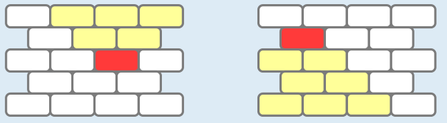
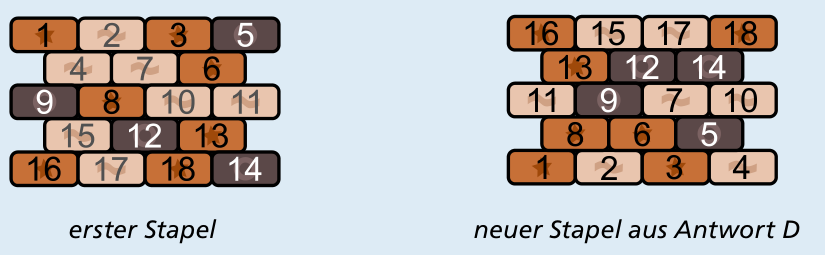
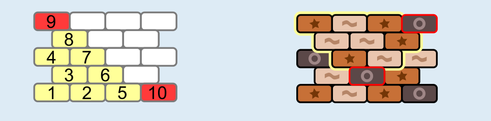
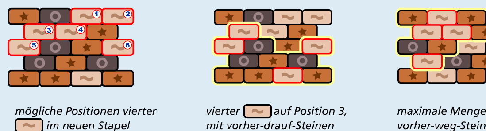

Antwort **D** ist richtig:

Zunächst stellen wir eine grundsätzliche Überlegung an. Im Bild links ist der rote Stein die Spitze eines umgedrehten Dreiecks, das ansonsten aus den sechs gelben Steinen besteht. Das sind genau die Steine, die vor dem roten Stein umgestapelt werden müssen. Zu jedem Stein im ersten Stapel gehört so ein „vorher weg“-Dreieck. Im Bild rechts sind die gelben Steine wiederum die, die vor dem roten Stein auf den neuen Stapel gelegt werden müssen. Dies ist das „vorher drauf“-Dreieck, das es für jeden Stein gibt.

Nummeriert man die Steine in der Reihenfolge, in der sie umgestapelt werden, gelten diese beiden Umstapel-Bedingungen: Jeder Stein im ersten Stapel hat eine größere Nummer als die anderen Steine in seinem „vorher weg“-Dreieck. Analog hat jeder Stein im neuen Stapel eine größere Nummer als die anderen Steine in seinem „vorher drauf“-Dreieck.

Das Bild unten zeigt, wie der Stapel von Antwort D aus dem ersten Stapel durch Umstapeln nach Bobs Methode erzeugt werden kann. Die Steine sind in der Reihenfolge nummeriert, in der sie umgestapelt werden, und die Umstapel-Bedingungen gelten:

Nun bleibt zu zeigen, dass die Stapel der Antworten A bis C nicht durch Umstapeln nach Bobs Methode erzeugt werden können.

**Antwort C:** In der unteren Reihe liegen vier Wellen-Steine. Ein zweiter Wellen-Stein kann frühestens als dritter Stein umgestapelt werden. Unter den ersten beiden Steinen, die umgestapelt werden, ist also einer kein Wellen-Stein, muss aber in die untere Reihe des neuen Stapels gelegt werden. Es ist also nicht möglich, dass im neuen Stapel vier Wellen-Steine in der unteren Reihe liegen.

**Antwort A:** Im Stapel aus Antwort A liegen drei Kreis-Steine in der unteren Reihe. Ein Stein in der unteren Reihe des neuen Stapels muss spätestens als 10. Stein umgestapelt worden sein (Bild links). Wenn man aus dem ersten Stapel den Kreis-Stein aus der vierten Reihe von oben nehmen will, muss Bob vorher alle neun Steine von dessen „vorher-weg“-Dreieck umstapeln (Bild rechts). Dieser Kreis-Stein kann also frühestens als 10. Stein umgestapelt werden und ist dann der zweite Kreis-Stein im neuen Stapel. Ein dritter Kreis-Stein kann deshalb frühestens als 11. Stein umgestapelt werden. Es ist also nicht möglich, dass im neuen Stapel drei Kreis-Steine in der unteren Reihe liegen.

**Antwort B:** Nun betrachten wir noch den Stapel von Antwort B: Der vierte Wellen-Stein, der auf diesen Stapel gelegt wird, kann dort an den im Bild unten links markierten sechs Positionen liegen. Wenn man alle diese Positionen betrachtet und jeweils alle Möglichkeiten, welche drei Wellen-Steine vorher auf den Stapel gelegt werden können, stellt man fest: Es müssen mindestens 3 Kreis-Steine vor dem vierten Wellen-Stein auf den Stapel gelegt werden, nämlich u. a. wenn der vierte Wellen-Stein auf Position 3 gelegt wurde. (Das Bild unten Mitte zeigt, welche Steine in diesem Fall vor dem vierten Wellen-Stein auf den neuen Stapel gelegt werden müssen.) Es ist aber nicht möglich, aus Bobs erstem Stapel so viele Kreis-Steine vor dem vierten Wellen-Stein umzustapeln: In Bobs erstem Stapel ist der Stein links in der zweiten Reihe von unten derjenige Wellen-Stein, der als vierter Wellen-Stein umgestapelt werden kann, so dass vorher möglichst viele andere Steine umgestapelt werden können. Dieser Wellen-Stein wird dann vor den anderen Steinen in seiner Reihe und vor denen in der unteren Reihe umgestapelt. Vor ihm können also höchstens 2 Kreis-Steine umgestapelt werden (siehe Bild rechts). Das reicht also nicht.

## Das ist Informatik!

Weil Bob so ordentlich nach seiner Methode arbeitet, kann er die Steine nicht in beliebiger Reihenfolge umstapeln. Aus der Lage der Steine in seinem ersten Stapel ergeben sich viele Abhängigkeiten zwischen jeweils zwei Steinen bezüglich der Reihenfolge. Zum Beispiel gilt für den Stein links in der zweiten Reihe von oben, dass sowohl der Stein ganz links in der obersten Reihe als auch der Stein rechts daneben vorher umgestapelt werden muss. Der Stein selbst muss wiederum vor sowohl dem Stein ganz links in der dritten Reihe von oben als auch dem Stein rechts daneben umgestapelt werden. Insgesamt entsteht so eine „Umstapel-Ordnung“. Sie legt für viele Stein-Paare fest, dass der eine Stein vor dem anderen umgestapelt werden muss – aber nicht für alle möglichen Stein-Paare.

In der Informatik muss man häufig mit Ordnungen umgehen, die genau so unvollständig sind wie die Umstapel-Ordnung in dieser Biberaufgabe. Wenn die zeitliche Abfolge von Arbeitsschritten in einem Produktionsprozess per Computer geplant wird, ist für einige Paare von Arbeitsschritten bekannt, welcher vor dem anderen ausgeführt werden muss – aber nicht für alle Paare. Wenn ein neues Softwarepaket auf einem Computer installiert wird, müssen vorher meist einige andere Pakete installiert werden, und für einige Paare dieser Pakete ist eine Installationsreihenfolge bekannt – aber nicht für alle. Dennoch muss es am Ende eine Reihenfolge geben, in der alles schön nacheinander passiert. Es gibt einen erfreulicherweise einfachen Algorithmus, der eine solche topologische Sortierung auf Grundlage einer unvollständigen Ordnung berechnen kann.
