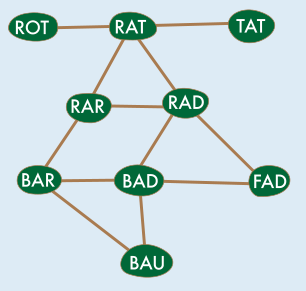
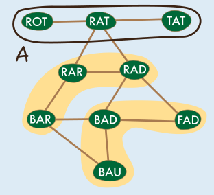
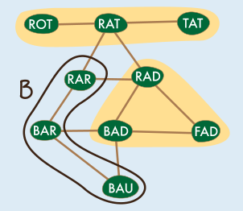
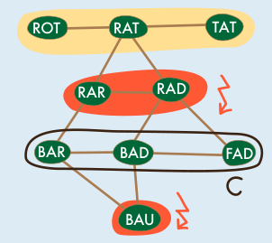
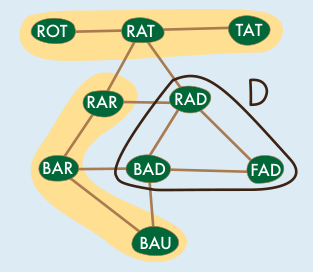

Antwort **C** ist richtig:

Wir können diese Aufgabe mithilfe einer Zeichnung lösen: Zunächst schreiben wir alle Wörter auf. Dann verbinden wir mit einer Linie je zwei Wörter, die sich an genau einer Position unterscheiden.

In Antwort A wird die Wortkette ROT — RAT — TAT gebildet. Aus den übrigen Wörtern lassen sich zum Beispiel die gelb markierten Wortketten bilden. Alle Wörter werden genau einmal benutzt. Alle Wortketten bestehen aus drei Wörtern.

Die Wortkette in Antwort B ist BAU — BAR — RAR. Aus den übrigen Wörtern können wir die gelb markierten Wortketten bilden. Alle Wörter werden genau einmal benutzt. Alle Wortketten bestehen aus drei Wörtern.

In Antwort C wird die Wortkette BAR — BAD — FAD gebildet. Es fällt auf, dass BAU isoliert wird. Wir können mit den übrigen Wörtern die gelb markierte Wortkette bilden, aber die zwei rot markierten Wörter und das Wort BAU können nicht verbunden werden. Sie bleiben übrig.

Die Wortkette in Antwort D ist BAD — FAD — RAD. Aus den übrigen Wörtern können wir die gelb markierten Wortketten bilden. Alle Wörter werden genau einmal benutzt. Alle Wortketten bestehen aus drei Wörtern.

Die Wortkette in Antwort C darf die Klasse also auf keinen Fall zuerst bilden.

## Das ist Informatik!

In den Zeichnungen, mit welchen wir den Lösungsweg erläutert haben, ist jedes Wort ein (grün hinterlegter) Knoten. Und eine Kante zwischen zwei Knoten (als Linie gezeichnet) zeigt, dass sich diese zwei Wörter an genau einer Position unterscheiden. Diese zwei Knoten sind dann Nachbarn. In der Wortkette BAD — RAD — RAT — ROT sind zum Beispiel BAD und RAD Nachbarn, aber BAD und RAT sind es nicht. Konstruktionen aus Knoten und Kanten sind in der Informatik allgemein als Graphen bekannt und werden eingesetzt, um mit den Kanten Zusammenhänge zwischen den durch die Knoten dargestellten Objekten darzustellen.

Die Wortkette BAD — RAD — RAT umfasst drei Knoten und zwei Kanten. Zwischen BAD und RAT besteht ein Weg, der die entsprechenden Knoten über den gemeinsamen Nachbarn RAD miteinander verbindet. Von jedem der neun Wörter aus können wir alle anderen Wörter erreichen. Dies kann direkt (d.h. wenn die entsprechenden Knoten Nachbarn sind) sein oder mithilfe eines längeren Wegs, der sich über mehrere Nachbarn erstreckt. Um diese Biberaufgabe zu lösen, werden drei solcher Wege benötigt. Dabei muss jeder Knoten genau einmal verwendet werdet werden, so dass, wenn man nur die Wege und keine weiteren Kanten betrachtet, der Graph am Ende in drei Komponenten zerlegt ist.

Graphen sind ein beliebtes Werkzeug der Informatikerinnen und Informatiker, um komplexe Sachverhalte zu modellieren. Programme können mithilfe von Graphen viele Aufgaben lösen. Navigationssysteme sind zum Beispiel Programme, die mithilfe sehr großer Graphen Autos schrittweise vom Startort bis zum Zielort führen. Mit jedem Schritt fährt das Auto über eine Kante von einem Knoten zu einem Nachbarn.
