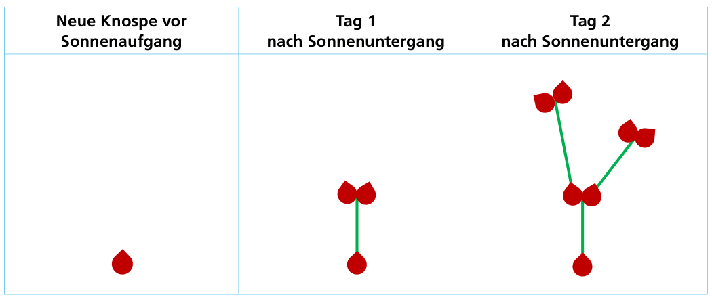
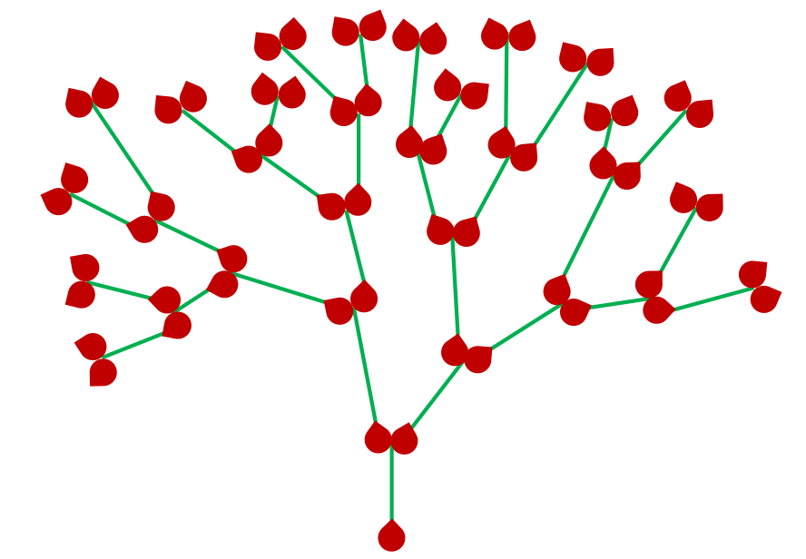

Bei Sonnenaufgang wächst aus jeder neuen Knospe der Wunderblume ein Stiel. Den ganzen Tag lang wächst der Stiel weiter. Bei Sonnenuntergang hört der Stiel auf zu wachsen, und es kommen zwei neue Knospen heraus. So geht es Tag für Tag weiter, und die Wunderblume wird immer prächtiger.

Hier ist eine Wunderblume:

**Wie viele Tage ist diese Wunderblume gewachsen?**
