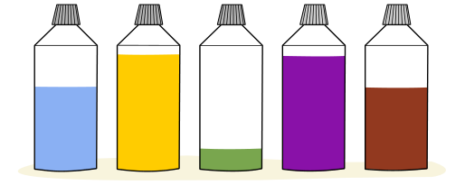

Bea malt ein Bild. Sie hat fünf Flaschen mit Farbe. Am Anfang sind alle Flaschen voll. Für große Flächen auf dem Bild braucht sie mehr Farbe als für kleine Flächen. Als Bea fertig ist, enthalten die Flaschen noch so viel Farbe:

**Welches Bild hat Bea gemalt?**
