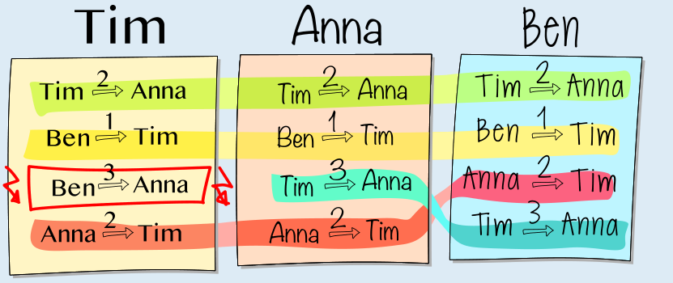

Antwort **C** ist richtig:

Wenn niemand einen Fehler gemacht hätte, müssten auf jedem Zettel die gleichen Einträge stehen. Drei Einträge sind auf allen Zetteln gleich. Sie sind im Bild durch eine grüne, gelbe und rote Linie markiert. Nur bei einem Eintrag gibt es einen Unterschied: Auf zwei Zetteln (Anna und Ben) findet man den Eintrag „Tim 3 → Anna“, und nur auf Tims Zettel steht „Ben 3 → Anna“.

Wenn man annimmt, dass auf genau einem Zettel ein Eintrag falsch ist, muss Tim den Fehler gemacht haben.

## Das ist Informatik!

In der Sprache der Informatik würde man sagen, dass die Kinder in unserer Geschichte sich entschieden haben, ihre Daten (die Murmel-Leih-Einträge) nicht in einer gemeinsamen Datenbank (Zettel) zu verwalten, sondern je eine eigene Datenbank zu führen. Deshalb gibt es nun mehrere, getrennte Datenbanken, die dennoch – so die Erwartung – denselben Inhalt abbilden. Aber warum diese, scheinbar überflüssige, mehrfache Datenhaltung? Sie ist sinnvoll, wenn man auf ein zentrales System verzichten möchte, etwa weil es ausfallen könnte oder nicht verlässlich oder nicht vertrauenswürdig arbeiten könnte. Insgesamt sehen wir hier ein Beispiel für ein Peer-to-Peer-Netzwerk: Jedes Kind ist ein Peer, und jedes Peer hat die gleichen Rechte und Pflichten (nämlich die korrekte Speicherung der Ausleih-Daten) wie alle anderen. Zum Abgleich der Daten können die Kinder miteinander kommunizieren, so wie das auch Computer in einem Netzwerk tun können. In einem Peer-to-Peer-Netz funktioniert der Abgleich nur, wenn die meisten Peers ehrlich sind. Bei Unstimmigkeiten stimmen sie darüber ab, welche der Datenbanken korrekt ist; in der Aufgabe würden Anna und Ben diese Abstimmung gewinnen.

Die Gleichstellung der Peers und die Verteilung der Daten gehören zu den Grundgedanken der Blockchain-Technologie. Diese geht noch einen Schritt weiter, indem sie einen Konsensalgorithmus implementiert. Dieser wäre nur dann problematisch, wenn ein böswilliger Akteur mehr Rechenleistung kontrollierte als alle anderen Teilnehmer zusammen. Das ist de facto unmöglich, wenn das Netzwerk groß genug ist. In dieser Biberaufgabe ist Blockchain kein Thema; sie zeigt aber dennoch, wie das Vertrauen in einer nicht von vornherein vertrauenswürdigen Umgebung gestärkt werden kann, indem die Kontrolle unter allen Teilnehmern verteilt wird.
