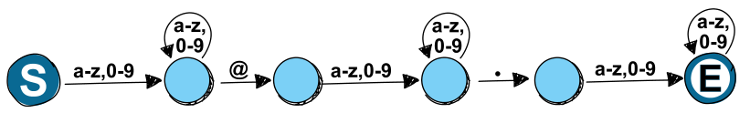
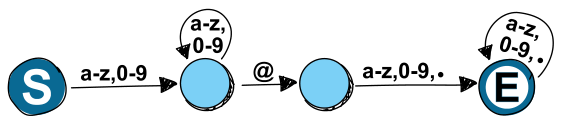
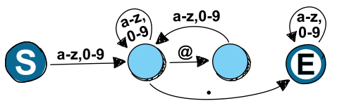

Die IT-Biber brauchen ein System, das erkennt, ob eine Zeichenfolge eine Biber-Mail-Adresse ist. Eine Biber-Mail-Adresse besteht aus drei Teilen:

- dem Benutzernamen: eine beliebige, nicht leere Zeichenfolge aus Kleinbuchstaben (a-z) und Ziffern (0-9),
- dem At-Zeichen (@) und
- dem Servernamen, der wiederum aus drei Teilen besteht:
  - dem Domänennamen: eine beliebige, nicht leere Zeichenfolge aus Kleinbuchstaben und Ziffern,
  - einem Punkt (.) und
  - dem Top-Level-Domänennamen: eine beliebige, nicht leere Zeichenfolge aus Kleinbuchstaben und Ziffern.

„Nicht leere“ Zeichenfolgen bestehen aus mindestens einem Zeichen. Ein Beispiel für eine Biber-Mail-Adresse ist: bebro@birke2.amfluss

Die IT-Biber überlegen sich vier Systeme und beschreiben sie mit Diagrammen aus Kreisen und Pfeilen. Ein Kreis steht für einen der Zustände, in denen das System sein kann. Ein Pfeil beschreibt den Wechsel zu einem nächsten, möglicherweise gleichen Zustand. Die Beschriftung des Pfeils sagt, zu welchen Zeichen dieser Zustandswechsel passt.

Ein System untersucht eine Zeichenfolge Zeichen für Zeichen, von links nach rechts, und ist zu Beginn im Zustand **S**. Der nächste Zustand hängt vom aktuell untersuchten Zeichen ab: Das System folgt dem Zustandswechsel, der zum aktuellen Zeichen passt. Ist das System nach dem letzten Zeichen im Zustand **E**, hat es die Zeichenfolge als Biber-Mail-Adresse erkannt.

**A)**

**B)**

**C)**

**D)**

**Nur eines dieser Systeme erkennt alle möglichen Biber-Mail-Adressen korrekt. Welches?**
