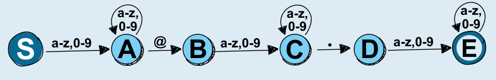

**Antwort A ist richtig:** Zur Erläuterung bezeichnen wir alle Zustände mit Buchstaben:

Der Wechsel (in der Informatik-Fachsprache: Übergang) von S zu A erkennt einen Kleinbuchstaben oder eine Ziffer, so dass der Benutzername nicht leer sein kann. Der Übergang von A zu A erlaubt, beliebig viele weitere Kleinbuchstaben oder Ziffern zu erkennen. Der Übergang von A zu B erkennt ein At-Zeichen. Der Übergang von B zu C erkennt einen Kleinbuchstaben oder eine Ziffer, so dass der Domänenname nicht leer sein kann. Der Übergang von C zu C erlaubt, beliebig viele weitere Kleinbuchstaben oder Ziffern zu erkennen. Der Übergang von C zu D erkennt einen Punkt. Der Übergang von D zu E erkennt einen Kleinbuchstaben oder eine Ziffer, so dass der Top-Level-Domänenname nicht leer sein kann. Der Übergang von E zu E erlaubt, beliebig weitere Kleinbuchstaben oder Ziffern zu erkennen. Zusammen entspricht das genau der Definition von Biber-Mail-Adressen aus der Aufgabenstellung.

**Antwort B ist falsch.** Dieses System erkennt beispielsweise auch „biber@internet“ oder „biber@.internet.com“. Diese Zeichenfolgen sind aber keine Biber-Mail-Adressen.

**Antwort C ist ebenfalls falsch.** Dieses System kann nur wenige Biber-Mail-Adressen erkennen, nämlich nur solche, deren Benutzername, Domänenname und Top-Level-Domänenname jeweils aus genau einem Buchstaben bestehen.

**Antwort D ist ebenfalls falsch.** Dieses System erkennt beispielsweise auch „biber@biberbau@amwasser.“, und diese Zeichenfolge ist keine Biber-Mail-Adresse.

## Das ist Informatik!

Die in dieser Biberaufgabe verwendeten Systeme sind *endliche Automaten* (engl. *finite-state automata*). Endliche Automaten sind sogenannte erkennende Maschinen, und zwar die einfachste Form. Sie bestehen aus einer Menge von Zuständen, von denen einer der Startzustand ist und eine Teilmenge die Endzustände enthält. Wenn ein endlicher Automat nach Untersuchung der gesamten Zeichenfolge in einem Endzustand ist, gilt das untersuchte Wort als erkannt. Mithilfe von Übergängen, die von den untersuchten Zeichen abhängen, bestimmt der endliche Automat den nächsten Zustand.

Zu jedem endlichen Automaten gibt es eine passende *reguläre Grammatik*, die genau alle Wörter erzeugen kann (die dazugehörige *reguläre Sprache*), die der endliche Automat erkennt. Ähnliche Analogien zwischen Grammatiken und Sprachen existieren auch für andere erkennende Maschinen, die in der *Chomsky-Hierarchie* für formale Sprachen systematisiert werden.

Die Sprachen, die von endlichen Automaten erkannt werden, können außerdem mit *regulären Ausdrücken* beschrieben werden. Der reguläre Ausdruck für die Biber-Mail-Adressen, wie sie in dieser Biberaufgabe definiert sind, lautet:

`[a-z0-9]+@[a-z0-9]+.[a-z0-9]+`

Endliche Automaten oder reguläre Ausdrücke werden an vielen Stellen eingesetzt, um Zeichenfolgen zu überprüfen: ob sie eine korrekt geformte Mail- oder Web-Adresse sind, ob sie bestimmten Anforderungen an ein Passwort entsprechen und vieles mehr. Zudem werden sie aufgrund ihrer einfachen Struktur auch in vielen eingebetteten Systemen verwendet, wo sehr wenig Strom verbraucht werden soll, beispielsweise weil die eingebetteten Systeme nur mit einer Batterie betrieben werden und mehrere Jahre laufen sollen.
