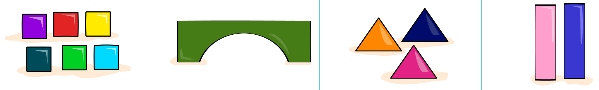
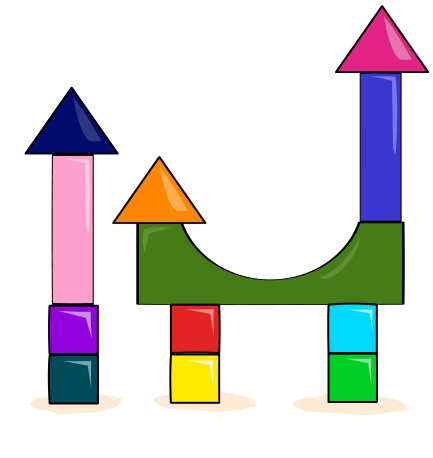

Ali hat diese Bauklötze:

Alis Schwester Zaha gibt ihm nach und nach Anweisungen, was er mit den Bauklötzen tun soll. Ali erledigt jede Anweisung sofort. Am Ende entsteht dieses Bauwerk:

**Bringe die Anweisungen in die Reihenfolge, in der Zaha sie gegeben hat.**
