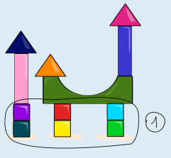
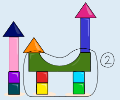
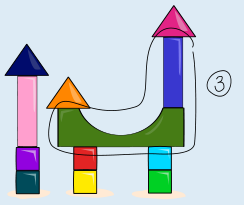
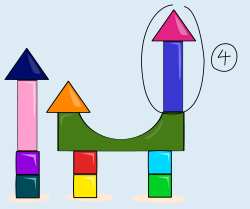

Zaha hat die Anweisungen in dieser Reihenfolge gegeben:

1. Baue drei Türme mit jeweils 2 Würfeln.
2. Stelle die Würfel-Türme in eine Reihe.
3. Lege die Brücke auf dein Bauwerk.
4. Stelle beide Quader auf dein Bauwerk.
5. Lege die Pyramiden auf dein Bauwerk.

Wir erklären, warum genau diese Reihenfolge Alis Bauwerk entstehen lässt.

Weil die Würfel-Türme die einzigen Teile sind, die direkt auf dem Boden stehen, müssen sie als erste gebaut (1. Anweisung) und danach in eine Reihe gestellt werden (2. Anweisung).

Danach muss die Brücke auf das bisherige Bauwerk gelegt werden (3. Anweisung). Sie muss auf die Würfel-Türme gelegt werden, aber unter den Quadern und Pyramiden sein.

Danach müssen die Quader aufgestellt werden (4. Anweisung). Sie stehen nämlich direkt auf der Brücke, sind aber unter den Pyramiden.

Zuletzt werden die Pyramiden gelegt (5. Anweisung). Sie liegen auf den Quadern, und es gibt keinen anderen Klotz, der auf die Pyramiden gebaut werden soll.

Da die meisten Anweisungen sagen, dass Klötze auf das (bisherige) Bauwerk gesetzt werden sollen, hängt die Reihenfolge der Anweisungen direkt damit zusammen, welche Klötze auf bzw. unter welchen anderen stehen.

Es ist nicht möglich, das Bauwerk mit einer anderen Reihenfolge der Anweisungen zu bauen.

## Das ist Informatik!

Wenn eine Menge von Bauklötzen einzeln nebeneinander auf dem Boden stehen, kann man im Nachhinein nicht sagen, in welcher Reihenfolge die Klötze auf den Boden gestellt wurden. Die Handlungen, also das Legen oder Stellen eines Klotzes auf den Boden, sind voneinander unabhängig. Wenn man Bauklötze aufeinander stellt, geht das nur der Reihe nach, und der unterste Klotz wurde zuerst, der oberste Klotz zuletzt benutzt. Das Ablegen des untersten Klotzes ist Voraussetzung dafür, dass der nächste Klotz darauf abgelegt werden kann.

Computerprogramme bestehen aus einer Folge einzelner Anweisungen, so wie die von Zaha in dieser Biberaufgabe. Dabei können die einzelnen Anweisungen einfach sein und entsprechend einfache Auswirkungen haben, sie können aber auch sehr kompliziert sein. Auf jeden Fall ist es wichtig, dass Informatikerinnen und Informatiker sich beim Programmieren sehr gut überlegen, welche Wirkungen die einzelnen Anweisungen haben – und welche Wirkungen anderer Anweisungen eine Anweisung voraussetzt. Wenn man sich das vor dem Programmieren genau überlegt, hat man keine Schwierigkeiten, die Anweisungen im Programm in die richtige Reihenfolge zu bringen – so wie du das in dieser Biberaufgabe gemacht hast.
