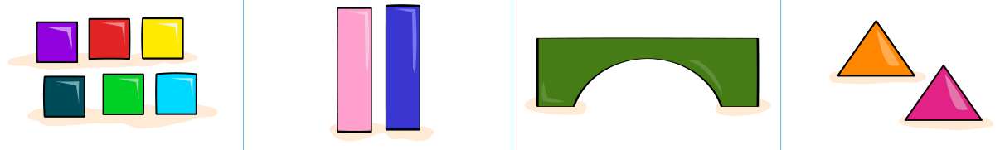
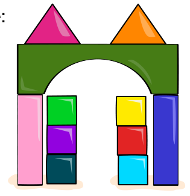
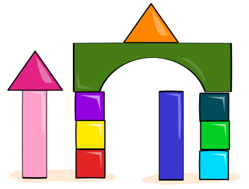

Du hast diese Bauklötze:

Dein Freund gibt dir diese Anleitung, um aus den Klötzen Bauwerke zu bauen:

1. Nimm drei Würfel.
2. Staple die Würfel übereinander, um einen Turm zu bauen.
3. Baue einen weiteren Turm mit den drei restlichen Würfeln.
4. Stelle die Quader neben die Türme.
5. Lege die Brücke auf dein Bauwerk.
6. Nimm die beiden Pyramiden und lege sie auf dein Bauwerk.

Beim Bauen musst du dich an die Reihenfolge der sechs Anweisungen halten. Mit der Bauanleitung kannst du trotzdem viele verschiedene Bauwerke bauen.

Zwei Beispiele:

Hier sind vier weitere Bauwerke. Eines davon kannst du NICHT mit der Bauanleitung bauen.

**Welches?**
