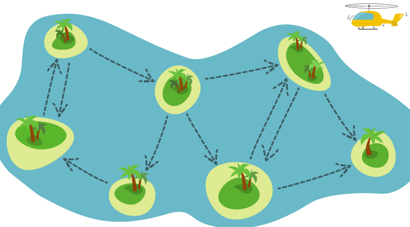

Vor der Küste von Bebrasien liegen sieben Inseln.

Zwischen den Inseln kann man mit Fähren fahren, aber nur in Richtung der Pfeile (gestrichelte Pfeile mit Schiff-Symbol).

Ein Forschungsteam möchte die Tierwelt auf allen sieben Inseln erkunden. Ein einzelner Ausflug des Teams zu den Inseln läuft so ab:
Das Team …

1. … fliegt mit einem Hubschrauber zu irgendeiner Insel,
2. benutzt die Fähren, um weitere Inseln zu besuchen, und
3. kehrt zum Schluss zur Insel mit dem Hubschrauber zurück, um zurückzufliegen.

Das Team stellt fest: Ein einziger Ausflug reicht nicht, um alle Inseln zu besuchen.

**Wie viele Ausflüge muss das Team dazu mindestens machen?**
