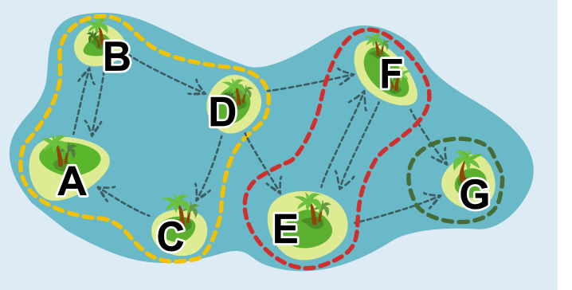

**3 Ausflüge ist die richtige Antwort.**

Um auf die Mindestzahl an Ausflügen zu kommen, muss das Team bei jedem Ausflug möglichst viele Inseln besuchen. Das Forschungsteam muss aber auch am Ende eines Ausflugs zur „Startinsel“ mit dem Hubschrauber zurück. Bei einem Ausflug kann das Team außer der Startinsel also nur solche Inseln besuchen, von denen aus es wieder zur Startinsel zurückkehren kann.

Wir teilen deshalb die Inseln in Gruppen ein. In jeder Gruppe sind so viele Inseln wie möglich, so dass gilt: Von jeder Insel einer Gruppe aus kann man mit den Fähren jede andere Insel der Gruppe besuchen. Dann kann das Team bei einem Ausflug irgendeine Insel der Gruppe als Startinsel anfliegen und alle Inseln der Gruppe besuchen. Aber auch nicht mehr, denn: Wenn das Team eine Insel-Gruppe verlässt, kommt es nicht mehr zu der Gruppe und damit auch nicht zum Hubschrauber zurück. Das Team muss also so viele Ausflüge machen, wie es Gruppen gibt.

Eine Gruppe kann man so finden: Man wählt eine beliebige Insel, die noch keiner Gruppe zugeordnet ist, als erste Insel einer neuen Gruppe. Dann ordnet man der neuen Gruppe alle Inseln zu, zu denen man von der ersten Insel aus fahren und von denen man auch zu ihr zurückfahren kann. Das Bild zeigt, dass die sieben Inseln aus drei solchen Gruppen bestehen: {A,B,C,D}, {E,F} und {G}. Das Forschungsteam muss also drei Ausflüge machen, um alle Inseln zu besuchen.

Aber wieso genügt nicht ein Ausflug? Man kann doch von einigen Inseln (zum Beispiel: C) aus alle anderen Inseln besuchen! Aber dabei verlässt man die Gruppe der ersten Insel und kommt nicht zu ihr und damit nicht zum Hubschrauber zurück.

## Das ist Informatik!

Die Inseln sind durch die Fähren teilweise miteinander verbunden. Inseln und Fährverbindungen kann man als Graph modellieren. Ein *Graph* ist eine Struktur, die Beziehungen zwischen Objekten beschreibt – wie die Fährverbindungen zwischen den Inseln in dieser Biberaufgabe. Dabei sind die Inseln die *Knoten* und die Fährverbindungen die *gerichteten Kanten* des Graphen.

Entsprechend lässt sich auch das Konzept der Gruppen auf Graphen übertragen: Eine Gruppe ist eine Menge von Knoten, so dass jedes Knoten-Paar aus dieser Menge direkt oder indirekt durch die Kanten des Graphen verbunden ist. Bei Graphen heißen solche Gruppen *starke Zusammenhangskomponenten* (SZK). Bei vielen Anwendungen von Informatiksystemen spielen Graphen und ihre starken Zusammenhangskomponenten eine wichtige Rolle. Einige Beispiele:

- Im World-Wide-Web sind SZKs Gruppen von Websites, die alle direkt oder indirekt miteinander verlinkt sind.
- In sozialen Netzwerken sind SZKs „Blasen“ von Nutzern, die sich in einem Netzwerk alle direkt oder indirekt gegenseitig folgen.
- In Verkehrsnetzen sind SZKs Regionen, in denen zwischen allen Haltestellen Fahrten möglich sind.

Die Informatik kennt Algorithmen, mit denen man die SZKs eines Graphen effizient ermitteln kann. Am bekanntesten und besten ist der Algorithmus von Tarjan. Robert Tarjan ist ein US-amerikanischer Informatiker, der alleine oder zusammen mit anderen viele Algorithmen erfunden hat, von denen einige nach ihm benannt wurden. Er war erst 38 Jahre alt, als er mit dem wichtigsten Preis der Informatik ausgezeichnet wurde, dem „Turing Award“.
