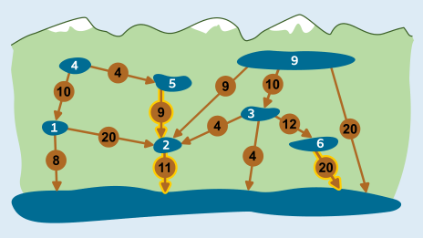
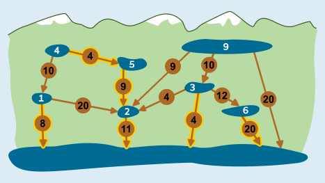
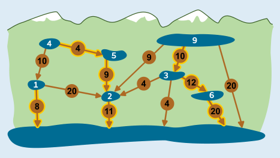

Wir nennen die Seen nach ihrem Wasserüberschuss: See 1, See 2 usw.

Für einige Seen gibt es nur eine Stelle, an der ein Kanal Wasser ableiten kann. Das sind die Seen mit Wasserüberschuss 2 unten Mitte (kurz: See 2), 5 und 6. An diesen Stellen muss also ein Kanal gebaut werden. Die Kapazitäten dieser Kanäle genügen für diese drei Seen, auch wenn man bedenkt, dass aus See 2 durch den Zufluss aus See 5 ein Gesamtüberschuss von 7 abgeleitet werden muss. Der Bau dieser drei Kanäle kostet 11 + 9 + 20 = 40.

Für die Seen 1 und 4 gibt es jeweils zwei Kanalbau-Stellen. (a) Wenn der Kanal von 4 nach 5 gebaut wird, muss der Kanal von 2 in den großen See einen Überschuss von 4 + 5 + 2 = 11 ableiten. Damit ist seine Kapazität erschöpft, so dass See 1 nicht auch noch in See 2, sondern in den Stausee abgeleitet werden muss. Die Kosten sind dann insgesamt 4 + 8 = 12. (b) Alternativ kann der Kanal von 4 nach 1 gebaut werden. Wenn dann der Kanal von 1 nach 2 gebaut würde, müssten aus See 2 insgesamt 4 + 1 + 7 = 12 abgeleitet werden, was nicht möglich ist. Also muss in diesem Fall der Kanal von 1 in den Stausee gebaut werden. Die Kosten sind dann insgesamt 10 + 8 = 18, also höher.

Bleiben die Seen 3 und 9. (a) See 9 kann nicht in See 2 abgeleitet werden, weil das die Kapazität des Kanals von 2 in den Stausee übersteigt (übrigens auch, wenn es den Kanal von 4 nach 5 nicht gäbe). (b) Wird See 9 direkt in den Stausee abgeleitet, hätte die günstigste Gesamtlösung für die Seen 3 und 9 die Kosten 20 + 4 = 24. (c) Wird See 9 in See 3 abgeleitet, entsteht dort ein Überschuss von 12, der nur in See 6 abgeleitet werden kann. Der dort entstehende Überschuss 18 kann durch den bereits gebauten Kanal in den Stausee abgeleitet werden. Die Kosten für die Seen 3 und 9 sind dann 10 + 12 = 22, also günstiger.

Die gewählten Kanäle können alles überschüssige Wasser aus den Bergseen in den Stausee ableiten, und das zu minimalen Kosten von 40 + 12 + 22 = 74.

## Das ist Informatik!

Seen (Bergseen und Stausee) und Kanalbaustellen können als Graph modelliert werden. Ein Graph hat *Knoten* (hier: die Seen), von denen jeweils 2 durch *Kanten* (hier: die Kanalbaustellen) miteinander verbunden sein können. Wie in dieser Biberaufgabe können Kanten eine Richtung haben und außerdem ein *Gewicht* wie hier die potenzielle Kanal-Kapazität an den Baustellen.

Ein Problem mit Hilfe bekannter Strukturen zu modellieren, ist besonders sinnvoll, wenn man auch Algorithmen zur Lösung heranziehen kann, die die Informatik für Probleme auf diesen Strukturen kennt. Für Graphen sind viele Probleme gut beschrieben und für viele davon auch effiziente Lösungsalgorithmen bekannt. Dazu gehören auch Flussprobleme, wie etwa das „minimum cost flow problem“, die mit dem Problem in dieser Aufgabe verwandt sind.
