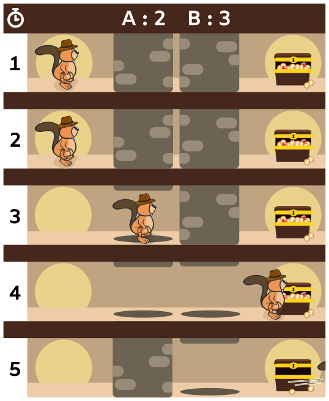
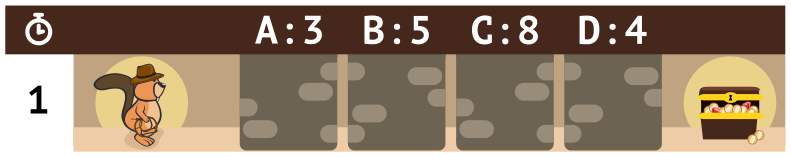

Biber Jones ist in einer perfiden Pyramide mit gefährlichen Gängen. Am Ende jedes Ganges befindet sich ein sagenhafter Schatz. Jones will jeden Schatz so schnell wie möglich erreichen.

Jedoch ist jeder Gang durch eine Reihe von Fallblöcken gesichert. Am Anfang sind alle Blöcke unten. Sobald jemand den Gang betritt, beginnen die Blöcke sich zu bewegen. Jeder Block bewegt sich in festem Takt nach oben und unten. Zum Beispiel schnellt ein Block mit Takt 2 nach 2 Minuten hoch und kracht nach weiteren 2 Minuten wieder herunter.

Jones steht vor seiner ersten Herausforderung:

Dieser Gang hat zwei Blöcke: Block A hat Takt 2, Block B Takt 3. Glücklicherweise hat Jones eine Schriftrolle mit Anweisungen gefunden, wie man so schnell wie möglich sicher den Schatz erreicht:

```
wait(2)
goto_block(A)
wait(1)
goto_treasure
```



Jones befolgt die Anweisungen: Er wartet 2 Minuten, geht dann zu Block A, wartet dort 1 Minute und geht dann zum Schatz. Er erreicht den Schatz nach 3 Minuten.

Jones bemerkt, dass er auch mit weniger Anweisungen den Schatz erreicht hätte, und zwar gleich schnell:

```
wait(3)
goto_treasure
```

Er kommt zum nächsten Gang. Der hat vier Blöcke, mit Takt 3, 5, 8 und 4.



**Baue die kürzeste Folge von Anweisungen, mit denen Jones so schnell wie möglich den Schatz erreicht.**
