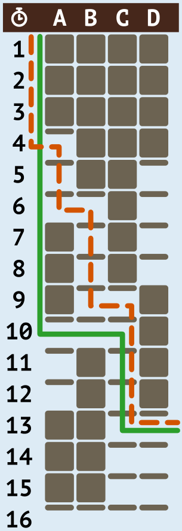

Das Bild zeigt, wie sich Jones durch den Gang bewegen kann:



Um sich immer so schnell wie möglich weiterzubewegen, kann er den folgenden Anweisungen folgen und den Schatz nach 12 Minuten (siehe orange Linie) erreichen:

```
wait(3)
goto_block(A)
wait(2)
goto_block(B)
wait(3)
goto_block(C)
wait(4)
goto_treasure
```

Es gibt aber eine kürzere Folge von Anweisungen, mit denen er ebenfalls nach 12 Minuten den Schatz erreicht (siehe grüne Linie):

```
wait(9)
goto_block(C)
wait(3)
goto_treasure
```

Es gibt keine Möglichkeit, mit noch weniger Anweisungen den Schatz zu erreichen, ohne Zeit zu verlieren. Die einzige Möglichkeit bestünde darin, dass Jones den Gang in einem Zug passiert. Dazu muss er aber 15 Minuten warten (erst dann sind alle Blöcke gleichzeitig oben) und wäre später beim Schatz.

## Das ist Informatik!

Biber Jones, der atemlose Abenteurer, will natürlich so schnell wie möglich den sagenhaften Schatz erreichen. Nicht, dass ihm jemand zuvorkommt! Aber als ordentlich organisierter Ober-Optimierer ist Jones nicht nur mit irgendwelchen Instruktionen zufrieden, die ihn flugs voranbringen. Nein, er sucht die kürzeste Anweisungsfolge, die das leistet. Er optimiert also mit gleich zwei Zielen bzw. fügt der Optimierung der Geschwindigkeit eine Nebenbedingung hinzu. Kein Problem für Jones!

Etwas schwieriger wäre, wenn Jones sich Optimierungsziele ausgesucht hätte, die nicht unbedingt miteinander verträglich sind: einerseits so schnell wie möglich beim Schatz zu sein, anderseits sein Hollywood-reifes Abenteurer-Outfit möglichst in Form zu halten. In Informatik und Mathematik spricht man in solchen Fällen von *Mehrzieloptimierung*. Dabei gibt es meist kein einziges Optimum, sondern mehrere *Pareto-Optima*. Ein Pareto-Optimum (benannt nach dem Ökonomen Vilfredo Pareto) ist ein Zustand, in dem es nicht möglich ist, einen Zielwert zu verbessern, ohne zugleich einen anderen zu verschlechtern.

Wie allen guten Informatikerinnen und Informatikern geht es Jones sehr um Qualität. Bei diesem Stichwort geht es in der Informatik nicht immer um die Qualität bzw. Optimalität von Berechnungsergebnissen. Es gibt zum Beispiel auch die Qualität von Programmcode, die sich an verschiedenen Kriterien wie der Strukturiertheit des Codes oder den enthaltenen Kommentaren bemessen kann. Auch kann unter verschiedenen Codes mit gleicher Funktion derjenige mit den wenigsten Anweisungen bevorzugt werden – so wie in dieser Biberaufgabe.
