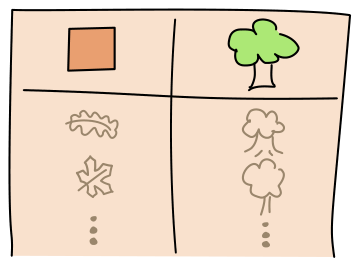
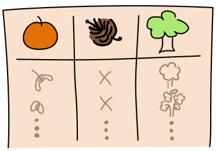
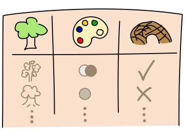

Eddie und seine Freunde gehen gern wandern. Während ihrer Wanderungen sammeln sie Informationen über die Bäume, die sie sehen, und notieren diese in lange Tabellen.

**Severin** sammelt Information über Blattformen und die zugehörigen Baumarten.

**Quirina** sammelt Informationen über Baumfrüchte, ob diese von Nadelbäumen stammen und über die zugehörigen Baumarten.

**Ladina** sammelt Informationen über Baumarten, über deren Holzfarben und darüber, ob sie Biberholz für Biberburgen liefern.

Eddie hat im Wald ein Blatt gefunden und kennt dessen Form. Nun möchte er erfahren, ob die zugehörige Baumart Biberholz für Biberburgen liefert.

**Welche seiner Freunde muss Eddie fragen, und in welcher Reihenfolge, um das zu erfahren?**
