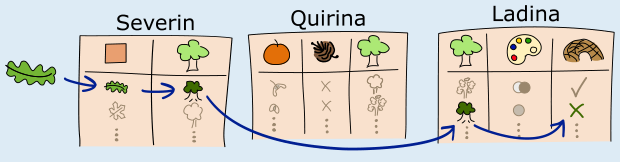
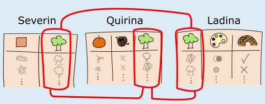

**Antwort C ist richtig:**

Die Information darüber, ob eine Baumart Biberholz liefert, findet sich nur in Ladinas Tabelle. Wenn Eddie jedoch nur Information über das Blatt hat, kann er keine Zeile aus Ladinas Tabelle auswählen. Er benötigt Information über die Baumart oder die Farbe des Holzes. Es genügt also nicht, nur Ladina zu fragen; Antwort A ist also falsch.

Quirinas Tabelle enthält weder Information über Blätter, noch über Biberholz. Ihre Tabelle nützt Eddie nichts, also sind die Antworten B und D falsch.

Aber Severins Tabelle enthält Information über Blätter. Da Eddie die Form des Blattes kennt, kann er zuerst die passende Zeile in Severins Tabelle auswählen und die fehlende Information über die Baumart erhalten. Anschließend kann er damit die passende Zeile in Ladinas Tabelle auswählen, um die gesuchte Information über das Holz zu erhalten. Wenn Eddie zum Beispiel anhand der Blattform und Severins Tabelle herausfindet, dass es sich um ein Eichenblatt handelt, kann er die passende Zeile in Ladinas Tabelle auswählen und herausfinden, ob Eichen Biberholz liefern.

## Das ist Informatik!

Diese Biberaufgabe veranschaulicht grundlegende Konzepte *relationaler Datenbanken*. Diese werden in Informatiksystemen extrem häufig eingesetzt, nämlich zur Verwaltung großer (und auch kleiner) Datenmengen. Relationale Datenbanken bestehen aus Tabellen mit Daten – so wie die von Eddies Freunden erstellten Tabellen. Tabellen heißen auch *Relationen*, und in einer Tabelle ist jede Spalte ein *Attribut* und jede Zeile ein Datensatz bzw. ein Element der durch die Tabelle gegebenen Relation. Die Verbindung zwischen Tabellen über ein gemeinsames Attribut – hier die „Baumart“ – entspricht dem Konzept der *Fremdschlüssel* in relationalen Datenbanken, die Beziehungen zwischen verschiedenen Tabellen herstellen.

Eddies Frage nach Information über gutes Bauholz für eine Biberburg anhand der Blattform würde in einem System mit Datenbanken als *Abfrage* bezeichnet. Diese Abfrage erfordert die Verknüpfung mehrerer Tabellen, um die gewünschte Information zu erhalten. Die Verknüpfungsoperation kombiniert Zeilen aus verschiedenen Tabellen anhand des gemeinsamen Schlüssels kurzzeitig zu einer gemeinsamen, größeren Tabelle. So können Daten, die über mehrere Tabellen verteilt sind (in diesem Fall Baumarten *species*, Blattform *shape* und Biberholz *beavertimber*), für die Beantwortung von Abfragen zusammengeführt werden. Die Daten in den Tabellen der Freunde können insbesondere über die Baumart *species* miteinander verbunden werden:

Relationale Datenbanken sind so wichtig, dass es in der Informatik für Abfragen und andere Operationen auf Datenbanken eine eigene Sprache gibt, nämlich SQL (Structured Query Language).
