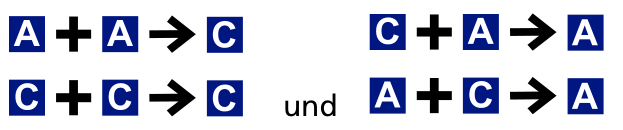
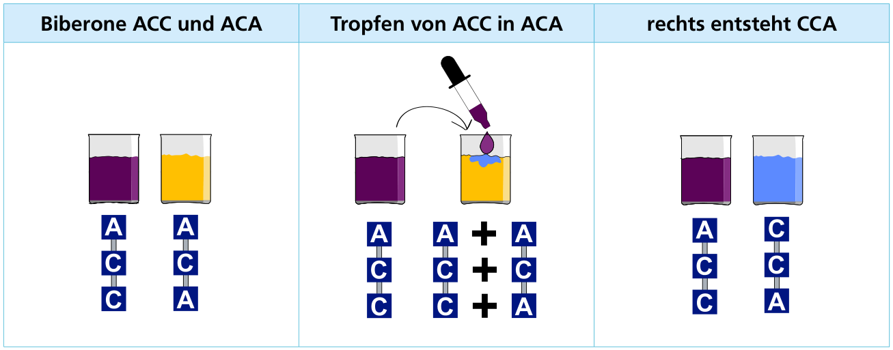
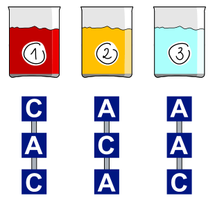

Ein Biberon ist ein besonderer chemischer Stoff: Seine Moleküle sind jeweils eine Folge von genau drei Bausteinen der Typen A und C. Diese Folge wird auch als Name des Biberons verwendet, zum Beispiel: ACA.

Wenn ein Biberon zu einem anderen Biberon hinzugefügt wird, entsteht wieder ein Biberon. Aus den Bausteinen in den Molekülen der beiden Biberone entstehen die Bausteine des neuen Biberons nach diesen Regeln:

Ein Beispiel: Wenn man einen Tropfen von ACC zu ACA hinzufügt, entsteht CCA:

Im Labor gibt es drei Behälter 1, 2 und 3 mit den Biberonen CAC, ACA und AAC.

Eine Anweisung „2 → 3“ bedeutet, dass ein Tropfen des Biberons in Behälter 2 dem Biberon in Behälter 3 hinzugefügt wird. Es gibt sechs verschiedene Anweisungen.

Verwende möglichst wenige davon, um die Biberone in den Behältern 1 und 3 zu vertauschen: Am Ende soll in Behälter 1 AAC sein, in Behälter 2 bleibt ACA, und in Behälter 3 soll CAC sein.

**Baue die Folge der Anweisungen mit der kleinsten möglichen Anzahl.**
