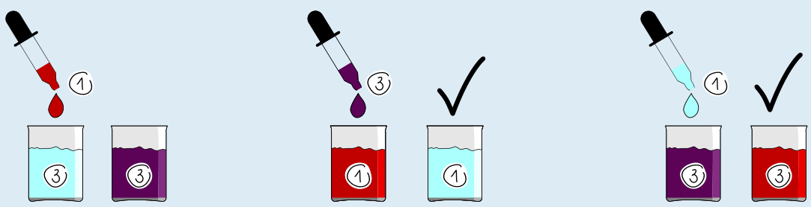

---
answers:
  - [g31, g13, g31]
  - [g13, g31, g13]
---
Die Biberone in den Behältern 1 und 3 können mit drei Anweisungen vertauscht werden. Es gibt zwei richtige Antworten: 3→1, 1→3, 3→1 und 1→3, 3→1, 1→3.

Wir veranschaulichen die zweite Antwort 1→3, 3→1, 1→3. Zu Beginn sind die Stoffe in den Behältern: 1: CAC, 2: ACA, 3: AAC.

- **1→3:** In Behälter 3 entsteht CAC + AAC → ACC. Die Stoffe in den Behältern sind nun: 1: CAC, 2: ACA, 3: ACC.
- **3→1:** In Behälter 1 entsteht ACC + CAC → AAC. Die Stoffe in den Behältern sind nun: 1: AAC, 2: ACA, 3: ACC.
- **1→3:** In Behälter 3 entsteht AAC + ACC → CAC. Die Stoffe in den Behältern sind nun: 1: AAC, 2: ACA, 3: CAC. Das ist die gewünschte Reihenfolge der Stoffe.

Nun zeigen wir, dass es nicht möglich ist, die Biberone in den Behältern 1 und 3 mit weniger als drei Anweisungen zu vertauschen. Eine einzige Anweisung reicht offensichtlich nicht aus: Damit kann man nur einen Stoff ändern, und wir müssen zwei Stoffe ändern.

Falls zwei Anweisungen ausreichen, muss durch die eine Anweisung in Behälter 1 das Biberon AAC und durch die andere Anweisung in Behälter 3 das Biberon CAC entstehen.

Betrachten wir zunächst den Fall, dass zuerst in Behälter 1 das Biberon AAC entstehen soll. Die beiden möglichen Anweisungen wirken so:

- 2→1: ACA + CAC → AAA
- 3→1: AAC + CAC → ACC

Es ist also nicht möglich, dass in Behälter 1 durch eine Anweisung AAC entsteht. Weil die zweite Anweisung nicht zwei Stoffe ändern kann, reichen in diesem Fall zwei Anweisungen nicht aus.

Betrachten wir nun den Fall, dass zuerst in Behälter 3 das Biberon CAC entstehen soll. Die beiden möglichen Anweisungen wirken so:

- 1→3: CAC + AAC → ACC
- 2→3: ACA + AAC → CAA

Es ist also nicht möglich, dass in Behälter 3 durch eine Anweisung CAC entsteht. Auch in diesem Fall reichen zwei Anweisungen nicht aus. Es werden also mindestens drei Anweisungen benötigt.

## Das ist Informatik!

Die Regeln, nach der aus den Bausteinen A und C der Baustein im neuen Molekül entsteht, entsprechen der logischen Operation XOR (engl.: *exclusive OR*, deutsch: *exklusives Oder*). Das kann man erkennen, wenn man A und C als die Wahrheitswerte „wahr“ bzw. „falsch“ auffasst: XOR liefert genau dann „wahr“, wenn seine beiden Operanden unterschiedliche Wahrheitswerte haben.

XOR hat in der Informatik eine besondere Bedeutung. Die „Swapping“-Eigenschaften dieser Operation können genutzt werden, um die Werte zweier Variablen auszutauschen, ohne dass eine dritte, temporäre Variable erforderlich ist – wie bei den Behältern in dieser Biberaufgabe.

XOR ist auch eine wichtige Operation in der Kryptografie. Stelle dir vor, du hast eine Nachricht, die als Binärcode dargestellt ist. Du kannst sie verschlüsseln, indem du sie per XOR mit einem Schlüssel gleicher Länge verknüpfst. Ein Beispiel: 01011 (Nachricht) XOR 11001 (Schlüssel) = 10010 (Chiffretext). Man kann die Nachricht wiederherstellen, indem man den Chiffretext mit dem Schlüssel per XOR verknüpft: 10010 (Chiffretext) XOR 11001 (Schlüssel) = 01011 (Nachricht). Ohne den Schlüssel bleibt die Nachricht aber vollständig verborgen, da jedes Bit des Chiffretexts gleichermaßen von einer 0 oder 1 in der Nachricht abgeleitet werden kann. Mit XOR arbeitet zum Beispiel die Stromverschlüsselung, die sich unter anderem für den Einsatz im Mobilfunk eignet.
