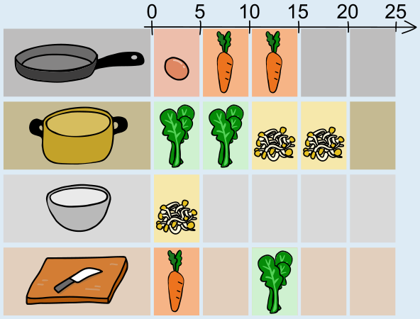

Der Koch kann mehrere Geräte gleichzeitig nutzen – aber ein Gerät kann zu jeder Zeit nur für eine Zutat verwendet werden. Es muss also für jedes Gerät überlegt werden, zu welchen Zeiten welche Zutaten damit verarbeitet werden können und der Plan für die Vorbereitung der Zutaten insgesamt am kürzesten ist.

Die Vorbereitung wird mindestens 20 Minuten dauern, denn sowohl Spinat als auch Sprossen müssen nacheinander jeweils 10 Minuten im Topf gekocht werden. Wenn zuerst der Spinat gekocht wird, können zur gleichen Zeit die Sprossen gewässert werden. In der Zeit, in der später dann die Sprossen kochen, kann der Spinat geschnitten werden. In der Pfanne wird am besten zuerst das Ei gebraten, denn dann kann der Koch in dieser Zeit schon die Karotten schneiden und sie nach dem Ei braten – so wie im Bild oben.

Der obige Plan zeigt, dass alle Zutaten nicht nur in mindestens 20 Minuten, sondern auch in höchstens 20 Minuten vorbereitet werden können. Alle Pläne, die insgesamt nicht länger als 20 Minuten benötigen und in denen (a) die Verarbeitungsschritte die richtigen Dauern haben und (b) die Verarbeitungsschritte der einzelnen Zutaten nacheinander und in der richtigen Reihenfolge stattfinden, sind richtige Antworten.

## Das ist Informatik!

In dieser Biberaufgabe geht es darum, einen Ablauf von Aktivitäten zu planen. Dies ist in der Informatik unter dem Begriff *Scheduling* bekannt. Wie bei vielen Scheduling-Problemen sind die zur Verfügung stehenden Ressourcen begrenzt: Topf, Pfanne, Brett und Schüssel gibt es jeweils nur einmal. Außerdem können einige Aktivitäten gleichzeitig passieren (der Koch ist wirklich toll!), während es andere gibt, die nacheinander passieren müssen – entweder, weil sie die gleiche Zutat oder das gleiche Gerät verwenden.

Scheduling ist ein recht altes Problem, und Gedanken dazu wurden sich schon gemacht, bevor es Computer gab. Die auch heute noch in Werkzeugen zur Projektplanung verwendeten Techniken stammen aber aus der Zeit der ersten Computer, nämlich aus den 1950er Jahren. Dazu gehört unter anderem die Methode des „kritischen Pfades“ (engl.: *Critical Path Method*, kurz: CPM), die in etwa dem entspricht, was wir oben in der Antworterklärung gemacht haben: nämlich eine Folge von voneinander abhängigen Aktivitäten zu bestimmen, die möglichst viel Zeit benötigt und deshalb ohne Pause zwischen den Aktivitäten durchgeführt werden sollte.

Kurz nach Veröffentlichung von CPM war John Fondahl, Professor an der Stanford University, unzufrieden mit den Computer-Implementierungen der Methode. Er hat dann eigene Ansätze präsentiert, CPM ohne Computer umzusetzen. Interessant ist, dass nun genau diese Ansätze bis heute in den meisten Softwarelösungen für Projektplanung umgesetzt werden – was John Fondahl auch vorhergesagt hat. Algorithmen gibt es schon seit weit über tausend Jahren, und auch heute noch lohnt es sich, über Algorithmen nachzudenken, ohne gleich zu überlegen, wie sie von Computern ausgeführt werden können. Am Ende gilt auch dann meist: Je besser der Algorithmus, desto besser ist er für die Umsetzung auf Computern geeignet.
