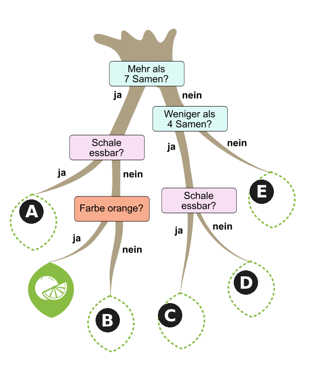

In einer Schulklasse werden Früchte analysiert. Für jede Frucht werden drei Eigenschaften betrachtet und aus den Werten die Fruchtsorte bestimmt. Die Eigenschaften sind: Äußere Farbe, Anzahl der Samen und Essbarkeit der Schale. Für zehn Früchte hat die Klasse deren Werte und die daraus bestimmten Fruchtsorten in einer Tabelle notiert:

| Farbe | Anzahl Samen | Schale essbar? | Fruchtsorte |
|---|---:|---|---|
| grün | 391 | nein | Wassermelone |
| gelb | 5 | ja | Apfel |
| orange | 9 | nein | Orange |
| gelb | 0 | nein | Banane |
| rot | 5 | ja | Apfel |
| grün | 0 | ja | Weintraube |
| rot | 206 | ja | Erdbeere |
| grün | 6 | ja | Apfel |
| orange | 10 | nein | Orange |
| rot | 173 | ja | Erdbeere |

Die Fruchtsorten werden mit dem Entscheidungsbaum oben bestimmt. Ein Entscheidungsbaum sieht aus wie ein Baum, der auf dem Kopf steht: Oben ist die Wurzel und unten sind die Blätter. Außerdem sind die Wurzel und die Astgabeln mit Fragen beschriftet, die man mit ja oder nein beantworten kann.

Zur Bestimmung der Fruchtsorte werden die Fragen im Baum anhand der Werte beantwortet. Das geht so: Beginne oben an der Wurzel. Beantworte die Frage dort und gehe auf den passenden Ast mit der richtigen Antwort (ja oder nein). Beantworte die nächste Frage und gehe auf den nächsten passenden Ast. Mache so weiter, bis du ein Blatt erreicht hast. Das Blatt zeigt die Fruchtsorte.

Nach den zehn Früchten ist der Entscheidungsbaum leider kaputt gegangen: Fast alle Blätter sind abgefallen. Nur das Blatt mit der Orange ist noch da.

**An welchen Stellen waren die Blätter? Ordne jeder Blatt-Stelle die passende Frucht zu.**
