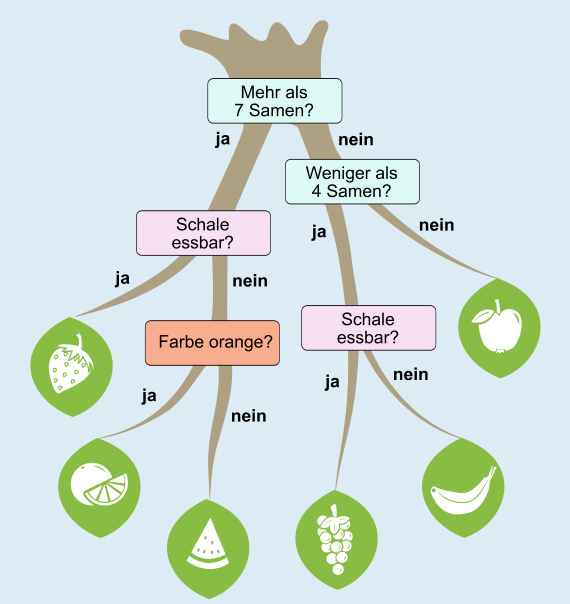
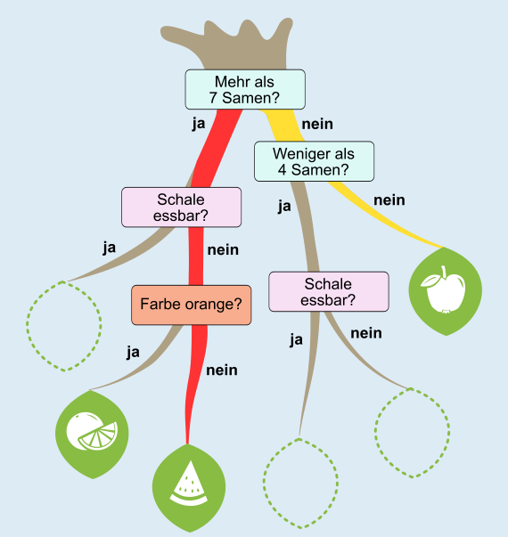

Die Früchte auf den Blättern sind (von links nach rechts): Erdbeere, Orange, Wassermelone, Trauben, Banane, Apfel.

Wie findet man die richtigen Stellen für die Blätter?

Die Fruchtsorten in der Tabelle wurden mit dem Entscheidungsbaum bestimmt. Gehen wir also die Zeilen der Tabelle durch und schauen wir, zu welcher Blatt-Stelle der Weg durch den Entscheidungsbaum anhand der Fragen führt. An dieser Stelle muss dann das Blatt mit der Fruchtsorte sein, die in der letzten Spalte der Tabelle angegeben ist. Das Bild zeigt für die ersten beiden Zeilen der Tabelle die Wege durch den Entscheidungsbaum:

**Zeile 1 (roter Weg):** Die Frucht hat 391 Samen (Mehr als 7 Samen? – Ja), ihre Schale ist nicht essbar (Schale essbar? – Nein), und die Frucht ist grün (Farbe orange? – Nein). Dieser Weg führt zur dritten Blatt-Stelle von links. Dorthin muss das Blatt mit der Fruchtsorte, die in dieser Zeile der Tabelle eingetragen ist: Wassermelone.

**Zeile 2 (gelber Weg):** Die Frucht hat 5 Samen (Mehr als 7 Samen? – Nein. Weniger als 4 Samen? – Nein). Der Weg führt zur Blatt-Stelle ganz rechts, dorthin muss also das Blatt mit dem Apfel.

In ähnlicher Weise führen

- Zeile 3 zur zweiten Blatt-Stelle von links, dort ist bereits die Orange;
- Zeile 4 zur zweiten Blatt-Stelle von rechts, dorthin muss die Banane;
- Zeile 5 zum Apfel;
- Zeile 6 zur dritten Blatt-Stelle von rechts, dorthin muss die Weintraube;
- Zeile 7 zur Blatt-Stelle ganz links, dorthin muss die Erdbeere.

## Das ist Informatik!

Ein *Entscheidungsbaum* ist ein einfacher, aber cleverer Weg, um Dinge in Sorten oder Gruppen einzuordnen (bzw. in Fachsprache: zu *klassifizieren*) und anhand dieser Einordnung Entscheidungen zu treffen. Entscheidungsbäume werden in vielen Informatiksystemen verwendet: zum Beispiel in medizinischen Diagnoseprogrammen, bei Online-Assistenten, die dir helfen, Produkte zu finden, und auch in Videospielen, wenn die Software entscheiden muss, wie eine Spielfigur reagieren soll.

Der Entscheidungsbaum in dieser Biberaufgabe wurde vorgegeben, zum Beispiel durch die Biologie-Lehrkraft. Sie hat den Baum aufgebaut und sich überlegt, welche Fragen wichtig sind, in welcher Reihenfolge sie gestellt werden müssen und wie der Baum sich verzweigen soll, damit die Früchte korrekt klassifiziert werden können.

In einem in den letzten Jahren immer wichtiger werdenden Bereich der Informatik, nämlich Künstliche Intelligenz (KI), geht es meist auch darum, beobachtete Daten zu klassifizieren und dann Entscheidungen zu treffen. Die nötigen Klassifikationswerkzeuge – wie etwa ein Entscheidungsbaum – sollen aber automatisch aus (den gleichen oder anderen) beobachteten Daten abgeleitet werden. Informatikmethoden zum automatischen Aufbau von Klassifikations- und Entscheidungsstrukturen aus Daten fallen unter Begriffe wie *Machine Learning* oder *Data Science*. Auch Entscheidungsbäume können „gelernt“, also automatisch aufgebaut werden, und zwar durch Algorithmen wie CART oder C4.5. Diese Methoden finden aus vielen Beispielen selbst heraus, welche Fragen wann gestellt werden müssen, um gute Entscheidungen zu treffen. Automatisch erzeugte Entscheidungsbäume kommen z. B. bei der Erkennung von Spam-E-Mails, medizinischen Diagnosen oder der Bestimmung von Pflanzenarten zum Einsatz.

Allerdings verwenden die meisten bekannten KI-Systeme keine Entscheidungsbäume. Stattdessen verwenden viele Systeme große Modelle aus neuronalen Netzen. Diese Strukturen enthalten keine nachvollziehbaren Entscheidungsfragen, sondern komplexe statistische Muster, die für Menschen meist schwer verständlich sind.
