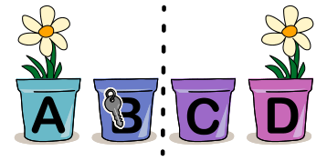
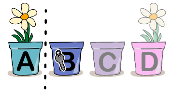

Biber Florian dekoriert den Eingang seines Baus mit Blumentöpfen. In manchen Töpfen ist **je eine Blume** gepflanzt, die anderen sind **leer**.

In einem Topf ist ein Schlüssel versteckt. Florian erklärt seine Methode, wie man den Schlüssel finden kann.

„Zuerst betrachtet man alle Töpfe und zählt, wie viele Blumen insgesamt in den Töpfen gepflanzt sind. Wenn die Anzahl an Blumen gerade ist, ist der Schlüssel in der linken Hälfte der Töpfe, sonst ist er in der rechten Hälfte. Jetzt betrachtet man nur die Hälfte, in der der Schlüssel ist, und wiederholt das Verfahren, bis nur noch ein Topf übrig ist. Dort ist der Schlüssel versteckt.“

Florian zeigt ein Beispiel, wie man den Schlüssel in 4 Töpfen A, B, C, D finden kann.

Betrachte die Töpfe A, B, C und D. Es gibt insgesamt 2 Blumen, also eine **gerade** Anzahl. Das heißt, der Schlüssel ist in der **linken** Hälfte, also in Topf A oder B.

Betrachte die Töpfe A und B. Es gibt insgesamt 1 Blume, also eine **ungerade** Anzahl. Das heißt, der Schlüssel ist in der **rechten** Hälfte, also in Topf B.

Florian hat acht Blumentöpfe (A bis H) und versteckt den Schlüssel in Topf C.

**In welche Töpfe sollte er eine Blume pflanzen, damit man den Schlüssel mit seiner Methode finden kann?** Es gibt mehrere richtige Antworten. Auch 0 ist eine gerade Zahl.
