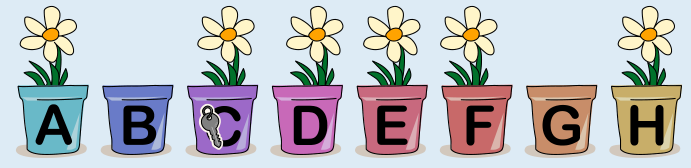
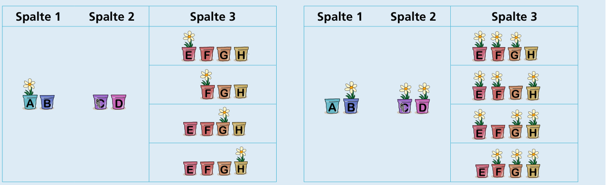

---
answers:
  - [a, e]
  - [a, f]
  - [a, g]
  - [a, h]
  - [a, e, f, g]
  - [a, e, f, h]
  - [a, e, g, h]
  - [a, f, g, h]
  - [a, c, d, e]
  - [a, c, d, f]
  - [a, c, d, g]
  - [a, c, d, h]
  - [a, c, d, e, f, g]
  - [a, c, d, e, f, h]
  - [a, c, d, e, g, h]
  - [a, c, d, f, g, h]
  - [b, e]
  - [b, f]
  - [b, g]
  - [b, h]
  - [b, e, f, g]
  - [b, e, f, h]
  - [b, e, g, h]
  - [b, f, g, h]
  - [b, c, d, e]
  - [b, c, d, f]
  - [b, c, d, g]
  - [b, c, d, h]
  - [b, c, d, e, f, g]
  - [b, c, d, e, f, h]
  - [b, c, d, e, g, h]
  - [b, c, d, f, g, h]
---
Eine richtige Antwort ist:

Eine andere richtige Antwort ist:

Es gibt noch mehr richtige Antworten, insgesamt 32 Stück. Man kann diese so bestimmen: Es ist am einfachsten, die Antwort „von unten nach oben“ zu konstruieren, sprich, bei kleinen Teilen der Antwort anzufangen und sich von da aus zur ganzen Antwort zu arbeiten.

- Wenn der Schlüssel in Topf C ist, werden beim Finden des Schlüssels zuletzt die Töpfe C und D betrachtet. Damit sich dabei für die linke Hälfte C entschieden wird, muss es in C und D eine gerade Anzahl Blumen geben. Also ist entweder in beiden Töpfen oder in keinem dieser Töpfe eine Blume.
- Im Schritt davor werden die Töpfe A bis D betrachtet. Weil sich dabei für die rechte Hälfte (C und D) entschieden werden soll, braucht es in A bis D eine ungerade Anzahl Blumen. Wie vorher beschrieben, hat die Hälfte C und D auf jeden Fall eine gerade Anzahl Blumen. Daher muss genau einer der beiden Töpfe A und B eine Blume enthalten.
- Im ersten Schlüssel-Finde-Schritt werden alle Töpfe betrachtet. Weil sich für die linke Hälfte (A bis D) entschieden werden soll, braucht man insgesamt eine gerade Anzahl Blumen. Da in der bereits betrachteten linken Hälfte eine ungerade Anzahl Blumen ist, braucht man auch in der rechten Hälfte (E bis H) eine ungerade Anzahl Blumen. Man kann sich also für E bis H zwischen entweder 1 oder 3 Blumen entscheiden und diese beliebig auf die Töpfe E, F, G und H verteilen.

Die folgende Tabelle fasst alle richtigen Antworten zusammen: Indem man aus jeder Spalte eine Option wählt, kann man eine richtige Antwort zusammenstellen. Auf diese Weise kann man alle 2 x 2 x 8 = 32 richtigen Antworten erhalten.

## Das ist Informatik!

Florian *kodiert* die Position des Schlüssels mit Hilfe einer Folge von Blumen in seinen Töpfen. Seine Freunde können diese Darstellung *dekodieren*, weil sie Florians Kodierungsmethode kennen. Damit Computer Daten verarbeiten können, werden die Daten nicht in einer für den Menschen natürlichen und gut verständlichen Form, sondern in einer für Computer lesbaren Form kodiert abgespeichert. Die Informatik kennt sehr viele Methoden zur Kodierung. Manche Kodierungen sollen dafür sorgen, dass Speicherplatz gespart wird; man spricht dann von *Komprimierung*. Wenn eine Kodierung zur Dekodierung über die Kenntnis der Kodierungsmethode hinaus die Kenntnis eines sogenannten „Schlüssels“ voraussetzt, spricht man auch von *Verschlüsselung*. In beiden Fällen ist wichtig, dass die Dekodierung genau die ursprünglichen Daten wiederherstellt, also eindeutig ist. Jede Kombination aus Töpfen mit und ohne Blumen legt eindeutig fest, in welchem Topf der Schlüssel versteckt ist, sodass der „Blumen-Code“ in dieser Biberaufgabe diese Anforderung erfüllt.

Florians Methode, den Schlüssel in den Blumentöpfen zu finden, funktioniert ähnlich zur *binären Suche*, da in jedem Schritt der Suchraum halbiert wird. Damit kommt man recht schnell zum Ziel. Bei doppelt so vielen Blumentöpfen bräuchte man nur einen Schritt mehr.

Die richtige Antwort lässt sich bei dieser Biberaufgabe am besten mit einem sogenannten *Bottom-up-Ansatz* finden. Dabei betrachtet man die kleinsten Teile der Antwort zuerst, da die größeren Teile davon abhängen. Statt alle möglichen Bepflanzungen der Töpfe durchzuprobieren, was hier schon 28 = 256 viele wären, kommt man so durch kluges Kombinieren schneller zu einer richtigen Antwort.
