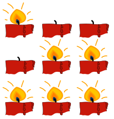

Es gibt eine Tradition, an den vier Sonntagen vor Weihnachten Kerzen anzuzünden: 1 Kerze am ersten Sonntag, 2 Kerzen am zweiten Sonntag und so weiter.

Chris liebt diese Tradition. Alle seine Kerzen sind gleich lang. Chris‘ Weihnachtsfest wäre wunderschön, wenn auch nach dem letzten Sonntag alle Kerzen noch gleich lang wären. Dafür müsste er jede Kerze insgesamt gleich oft anzünden.

Leider findet Chris keine Möglichkeit, ein wunderschönes Weihnachtsfest zu haben.

Wenn die Tradition nur drei Sonntage (und Kerzen) umfassen würde, wäre es möglich. Dann würde Chris jede Kerze genau zweimal anzünden:

Auch mit fünf Sonntagen (und Kerzen) wäre es möglich.

**Zeige Chris, wie er jede Kerze gleich oft anzünden kann.** Am 1. Sonntag brennt 1 Kerze, am 2. Sonntag 2 Kerzen, und so weiter. Für den fünften Sonntag sind die Kerzen bereits angezündet.
