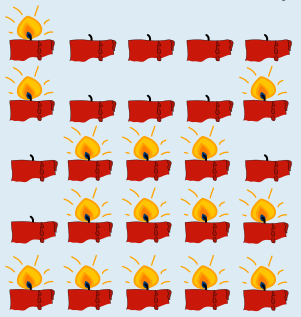

Chris kann die Kerzen so anzünden, jede einzelne genau dreimal:

Es gibt viele Möglichkeiten, dies zu erreichen. In allen Fällen kann man so vorgehen:

1. Man gruppiert die Sonntage in Paare, deren Nummern zusammen die Gesamtanzahl der Sonntage ergeben; bei fünf Sonntagen sind das die Paare 1 und 4 sowie 2 und 3.
2. Für jedes dieser Paare zündet man die Kerzen so an, dass die beiden Mengen an Kerzen, die an den jeweiligen Sonntagen angezündet werden, disjunkt sind – z. B. an Sonntag 1 die Kerze 1 (von links) und an Sonntag 4 die Kerzen 2 bis 5. (Betrachtet man jede Kerze als ein Bit mit 1 = angezündet, 0 = nicht angezündet, dann müssen für jedes Sonntage-Paar die beiden Kerzen-Bitfolgen der Sonntage bitweise komplementär zueinander sein.) So wird an den beiden Sonntagen eines Paares jede Kerze genau einmal angezündet.
3. Zusätzlich wird jede Kerze ein weiteres Mal am letzten Sonntag (Sonntag 5) angezündet.

Daher wird jede Kerze insgesamt gleich oft angezündet.

## Das ist Informatik!

Auf den ersten Blick scheint diese Bebras-Aufgabe ein ziemlich mathematisches Problem zu sein. Es gibt tatsächlich einen Beweis dafür, dass Chris' Kerzenproblem für jede ungerade Anzahl von Sonntagen lösbar ist. (Man erkennt, dass die in der Lösungserklärung vorgestellte Strategie generell für ungerade Sonntaganzahlen funktioniert.)

Wenn man jedoch konkret herausfinden will, wie man die Kerzen anzünden soll, muss man einen Algorithmus beschreiben, der die Anzündreihenfolge vorgibt – oder noch besser: einen, der alle möglichen Lösungen aufzählt. Dieser Algorithmus basiert auf der obigen Erklärung; sei *n* die (ungerade) Anzahl der Sonntage:

1. Am *n*-ten Sonntag: Zünde alle *n* Kerzen an.
2. Für *i* = 1 bis (*n* – 1)/2:
    (a) Zünde am Sonntag *i* die ersten *i* Kerzen an und am Sonntag *n* – *i* die letzten *n* – *i* Kerzen.

Beachte, dass Schritt 2a dieses Algorithmus auf alle Arten durchgeführt werden kann, welche die oben in der Erklärung unter Punkt 2 genannte Bedingung erfüllen.

Die Entwicklung von Algorithmen zur Problemlösung ist eine der wichtigsten Aufgaben von Informatikerinnen und Informatikern. Wenn ein Algorithmus auf solider mathematischer Modellierung beruht, lassen sich seine gewünschten Eigenschaften leichter beweisen als ohne eine solche Modellierung. Für den obigen Algorithmus kann man beweisen, dass er bei jeder ungeraden Anzahl von Sonntagen funktioniert.

Wie schade für Chris, dass die Tradition eine gerade Zahl an Sonntagen vorsieht. Vielleicht gelingt es ihm ja, den Präsidenten seines Landes zu überzeugen, die Tradition einfach auf fünf Sonntage umzustellen. Make Christmas Great Again!
