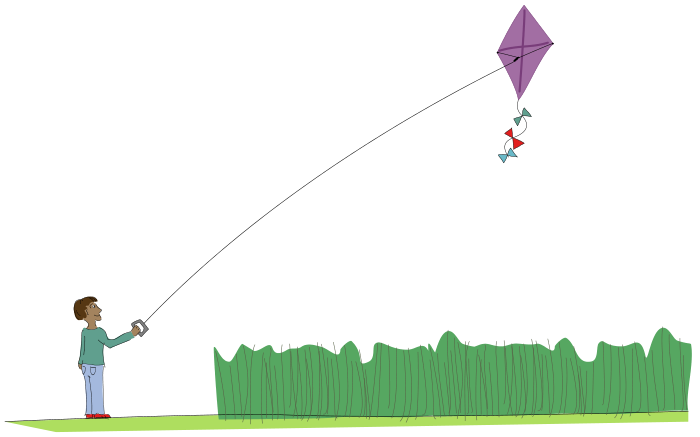
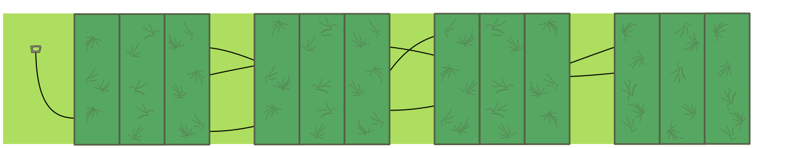

So ein Pech! Asterios hat seinen Drachen auf der Wiese verloren. Die Drachenschnur hat sich im hohen Gras verfangen, und es ist gar nicht so einfach, den Drachen wiederzufinden.

Die Wiese ist in 15 Felder unterteilt, die man einzeln durchsuchen kann.

Asterios hat schon 3 Felder der Wiese durchsucht (die hellgrünen Felder, in denen man die Schnur sieht). Er schaut sich genau an, wie die Schnur in diesen Feldern verläuft, und erkennt: Jetzt muss er nur noch ein weiteres Feld durchsuchen, um sicher zu wissen, wo der Drachen ist.

**Welches Feld ist das?**
