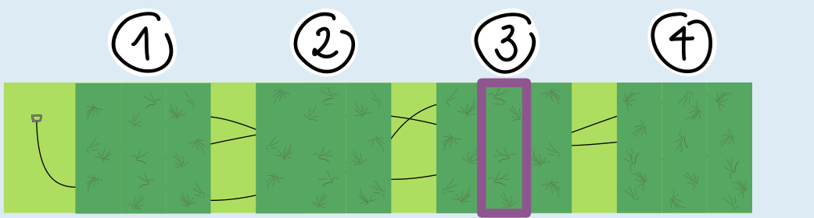
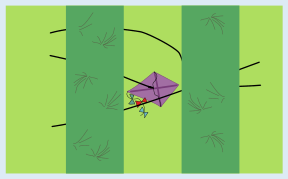
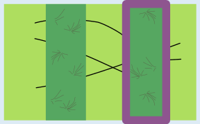
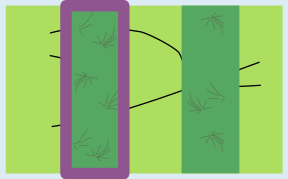

Asterios muss das violett markierte Feld durchsuchen (das mittlere Feld in Block 3), um sicher zu wissen, wo der Drachen ist.

Die Lösung kannst du in zwei Schritten finden. Zuerst überlegst du dir, in welchem der vier Blöcke 1, 2, 3 und 4 der Drachen liegen muss. Denke daran, dass die Drachenschnur links beginnt und der Drachen am anderen Ende der Schnur hängt.

Der Drachen kann sich nicht in Block 4 befinden, weil die Drachenschnur in Block 4 hineingeht und dort auch wieder herauskommt. Der Drachen muss sich rechts von Block 2 befinden, weil man zwischen Block 2 und Block 3 drei Schnursegmente sieht. Zwei Schnursegmente müssen zu einer Schlaufe im rechten Teil der Wiese gehören, und ein Schnursegment führt zum Drachen.

Wenn Asterios das mittlere Feld in Block 3 durchsucht, lassen sich drei Fälle unterscheiden:

Fall 1: In dem Feld liegt der Drachen. Super! Der Drachen ist gefunden und die Suche ist beendet.

Fall 2: In dem Feld sieht man keinen Drachen, aber drei Schnursegmente, die in das rechte Feld gehen. Weil aus diesem Feld nur zwei Schnursegmente nach rechts herausführen, muss der Drachen im rechten Feld liegen.

Fall 3: In dem Feld sieht man keinen Drachen, aber zwei Schnursegmente, die vom linken Feld zum rechten Feld gehen. Dann muss der Drachen links von diesem Feld liegen. Denn die beiden Schnursegmente gehören zu einer Schlaufe im rechten Teil der Wiese.

In jedem Fall wissen wir also nach dem Durchsuchen des Felds, in welchem Feld der Drachen ist.

## Das ist Informatik!

Beim systematischen Durchsuchen der Felder wird eine deterministische Suche durchgeführt: Jede neue Information – die Beobachtungen zu einem durchsuchten Feld – ermöglicht gezielte Schlussfolgerungen über benachbarte Felder. Eine wichtige Rolle spielt dabei eine *topologische* Eigenschaft der Drachenschnur: Die Schnur bildet geschlossene Schlaufen, und jeder durch zwei Geraden begrenzter Bereich (wie die Felder in dieser Biberaufgabe) enthält entweder eine gerade Anzahl von Segmenten oder die Wendestelle einer Schlaufe.

Topologische Eigenschaften beschreiben Strukturen, die durch die Anordnung und Verbindung von Elementen entstehen – unabhängig von Größen, Abständen oder Winkeln. Es geht also nicht darum, wie groß oder wie lang etwas ist, sondern wie Dinge miteinander verbunden sind und wie viele Wege oder Durchgänge es gibt.

Systematisches Durchsuchen mit topologischer Interpretation ist nicht nur ein spannendes Denkspiel, sondern hat auch praktische Bedeutung in der Informatik:

Ein Straßennetz kann zum Beispiel als System aus Punkten und Verbindungen betrachtet werden – etwa Kreuzungen und Straßen. Diese Struktur hilft Suchalgorithmen, zielgerichtet Wege zu finden, Umleitungen zu erkennen und zu zeigen, wie man möglichst rasch zum Ziel gelangt.

Auch bei der Fehlersuche in Stromnetzen liefert deren Topologie entscheidende Hinweise: Parallelschaltungen, Schleifen oder Unterbrechungen zeigen oft, wo der Fehler liegen könnte – ganz ohne genaue Maße, nur durch die logische Struktur des Netzwerks.
