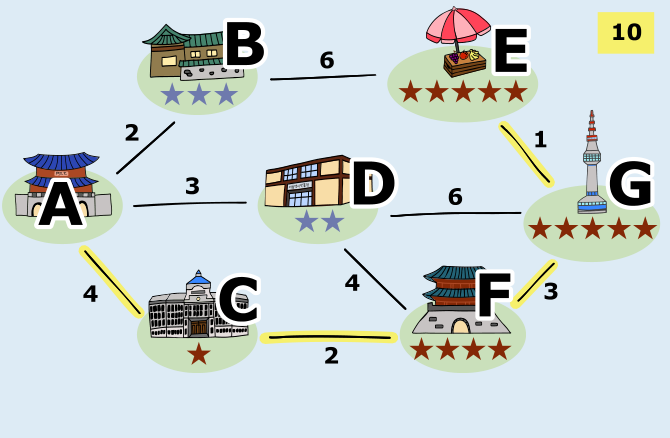

Wir wollen für Lotte eine Busroute finden, die vom Palast ausgeht, höchstens 10 km lang ist und mit der sie Sehenswürdigkeiten erreicht, die insgesamt möglichst viele Sterne haben. Deshalb sollten wir bei der Beschreibung von Routen nicht nur die einzelnen Sehenswürdigkeiten, sondern auch die Entfernung vom Palast und die Anzahl der auf der Route gesammelten Sterne berücksichtigen.

Zunächst bezeichnen wir die einzelnen Sehenswürdigkeiten mit den Buchstaben A bis G.

Einen Zwischenstopp auf einer Route bei einer Sehenswürdigkeit können wir nun beschreiben durch:

- den Buchstaben der Sehenswürdigkeit,
- die Gesamtentfernung vom Start (A) zu dieser Sehenswürdigkeit und
- die Gesamtzahl der auf dem Weg vom Start zu dieser Sehenswürdigkeit gesammelten Sterne.

Eine Route nennen wir gültig, wenn sie höchstens 10 km lang ist. Eine gültige Route führt beispielsweise

- von A nach B: B ist 2 km von A entfernt und hat 3 Sterne, so dass dieser Zwischenstopp mit B(2,3) bezeichnet wird;
- weiter von B nach E: die Gesamtentfernung wächst um 6 km auf 8 km, die Gesamtzahl der gesammelten Sterne steigt um 5 auf 8, so dass dieser Zwischenstopp mit E(8,8) bezeichnet wird;
- zuletzt von E nach G: es kommen 1 km Entfernung und 5 Sterne hinzu, so dass dieser Zwischenstopp, der gleichzeitig das Ende dieser gültigen Route ist, mit G(9,13) bezeichnet wird.

Das sind alle gültigen Routen:

- A → B(2,3) → E(8,8) → G(9,13)
- A → D(3,2) → G(9,7) → E(10,12)
- A → D(3,2) → F(7,6) → G(10,11)
- A → D(3,2) → F(7,6) → C(9,7)
- A → C(4,1) → F(6,5) → D(10,7)
- A → C(4,1) → F(6,5) → G(9,10) → E(10,15)

Die letzte gültige Route ist die beste, da ihr Endpunkt E(10,15) die höchste Gesamtzahl an Sternen aufweist. Lotte muss also die Verbindungen **A–C, C–F, F–G und G–E** fahren.

## Das ist Informatik!

Lotte hat in dieser Biberaufgabe ein Ziel: Sie möchte auf ihrer Route möglichst viele Sterne sammeln. Sie will also einen bestimmten Wert, nämlich die Gesamtzahl der Sterne, optimieren, d. h. den größtmöglichen Wert finden. Sprich: Lotte hat ein Optimierungsproblem. Beim Lösen dieses Problems ist sie durch ihre Fahrkarte eingeschränkt, die die Länge der Route begrenzt.

Die Informatik kennt viele Verfahren zur Lösung von Optimierungsproblemen, ob mit oder ohne Einschränkungen. Solche Probleme werden also häufig mit Hilfe von Informatiksystemen gelöst. Bei der Bestimmung optimaler Routen helfen Navigationssysteme. Sie erlauben ihren Benutzerinnen und Benutzern meist, den zu optimierenden Wert zu verändern: Soll die Route eine möglichst kurze Strecke haben oder soll möglichst wenig Energie verbraucht werden? Auch Einschränkungen sind möglich; zum Beispiel können Autobahnen, kostenpflichtige Straßen oder Fährverbindungen vermieden werden.

Informatik-Verfahren zur Routenfindung verwenden Datenstrukturen, die ganz ähnlich gezeichnet werden können wie das Busnetz in dieser Biberaufgabe, nämlich Graphen. Diese bestehen aus einer Menge von Knoten und einer Menge von Knotenpaaren, den Kanten. Mit Graphen lassen sich Beziehungen zwischen Dingen sehr gut modellieren; zum Beispiel Verkehrsverbindungen zwischen Orten. Entfernungen können dann als Gewichte mit den Kanten verbunden werden. Die Informatik kennt viele Algorithmen zur Lösung von Problemen, deren Daten als Graphen verwaltet werden – zum Beispiel die Tiefensuche, mit der wir oben die verschiedenen Routen für Lotte ermittelt haben.
