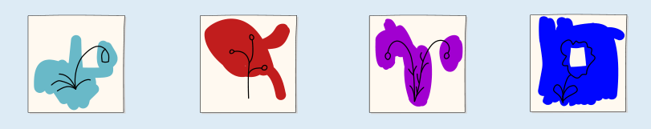

Hier siehst du, was sich auf den bemalten Zeichnungen (Bilder A bis D) hinter den Fingerfarben verbirgt:

Um die richtige Antwort zu finden, vergleichen wir

1. die schwarzen Linien jeder bemalten Zeichnung mit den Linien aller unbemalten Zeichnungen und
2. die weißen Bereiche jeder bemalten Zeichnung mit den weißen Bereichen aller unbemalten Zeichnungen.

Dabei stellen wir fest:

- Es gibt nur eine unbemalte Zeichnung mit einem weißen Bereich in der oberen linken Ecke wie in Bild A.
- Es gibt nur eine unbemalte Zeichnung mit einem Stiel in der unteren Hälfte wie in Bild B.
- Es gibt nur eine unbemalte Zeichnung mit einem weißen Bereich in der Mitte wie in Bild D.
- Damit bleibt genau eine unbemalte Zeichnung für Bild C übrig.

## Das ist Informatik!

Die kleine Carlotta hat die Zeichnungen ihres Bruders mit Fingerfarben bemalt. Danach konnte man kaum noch erkennen, wie die unbemalten Zeichnungen aussahen. Bei der Restaurierung von Kunstwerken in Museen bemühen sich Expertinnen und Experten, übermalte oder beschädigte Kunstwerke wieder in ihren ursprünglichen Zustand zu versetzen. Dabei müssen sie oft passende Referenzen aus anderen Quellen finden, um das Originalwerk genau wiederherzustellen. Dieser Prozess ähnelt dem, was du gerade in dieser Biberaufgabe gemacht hast.

In der Informatik werden Restaurierungstechniken in Systemen verwendet, die völlig neue Bilder erzeugen. Diese fortschrittlichen Systeme werden als *Diffusionsmodelle* bezeichnet. Ein Diffusionsmodell wird anhand zahlreicher Bilder trainiert, um zu lernen, wie beschädigte digitale Bilder restauriert werden können. Mit diesem Wissen kann das System dann aus Bildern, die aus vielen kleinen, verstreuten Punkten bestehen, neue Bilder erstellen. Es gibt jedoch einen wesentlichen Unterschied zu deinem Vorgehen bei dieser Aufgabe. Du hast die Aufgabe mit logischem Denken gelöst, während das Diffusionsmodell nicht mit Logik arbeitet. Stattdessen erlangt es seine Restaurierungsfähigkeiten, indem es mithilfe von maschinellem Lernen viele Beispiele analysiert.
