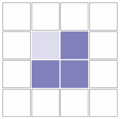
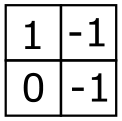

Digitale Bilder bestehen häufig aus Pixeln. Sandra erstellt Helligkeitskarten für solche Pixelbilder. Dazu legt sie um ein Bild zuerst einen Rahmen aus zusätzlichen weißen Pixeln. Dann bestimmt sie für jedes Pixel des Bildes einen Helligkeitswert, und zwar:

- **1**, falls das Pixel heller ist als sein rechtes Nachbarpixel.
- **0**, falls das Pixel gleich hell ist wie sein rechtes Nachbarpixel.
- **-1**, falls das Pixel dunkler ist als sein rechtes Nachbarpixel.

Hier siehst du ein Bild aus vier Pixeln (plus die zusätzlichen weißen Pixel) und seine Helligkeitskarte.

Unten siehst du vier Bilder mit je neun Pixeln. Genau drei davon haben die gleiche Helligkeitskarte.

**Welches der Bilder hat als einziges eine andere Helligkeitskarte?**
