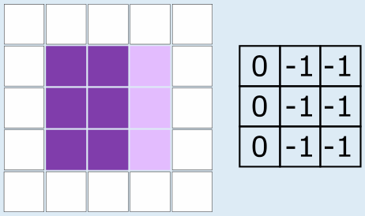
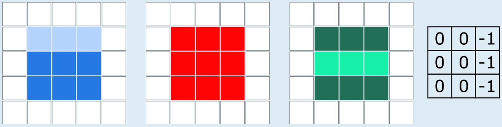

**Antwort B ist richtig:**

Die Helligkeitskarte von Bild B hat in jeder Zeile die Werte 0, -1, -1.

Die übrigen drei Bilder haben alle die gleiche Helligkeitskarte (in jeder Zeile 0, 0, -1):

Um die richtige Antwort zu finden, kann man die Helligkeitskarten aller vier Bilder berechnen und diese vergleichen. Oder man kann feststellen, dass eine Helligkeitskarte nur Helligkeitsunterschiede in horizontaler Richtung erfasst. Da die drei Bilder der Antworten A, C und D in horizontaler Richtung keine Helligkeitsunterschiede haben, müssen ihre Helligkeitskarten gleich sein.

## Das ist Informatik!

Für die Darstellung von Bildern in Computern kennt die Informatik viele verschiedene Formate. Grundsätzlich werden Bilder entweder als *Vektorgrafiken* oder als *Rastergrafiken* gespeichert. Bei Letzteren nennt man die einzelnen Rasterpunkte auch *Pixel* (kurz für: *picture element*). Jedes Pixel kann im einfachsten Fall schwarz oder weiß sein; dann kann man jedes Pixel durch ein einziges Bit mit den Werten 0 oder 1 darstellen. Farbige Pixel werden durch mehrere Werte beschrieben, die z. B. jeweils den Anteil der Farben Rot, Grün und Blau in der Farbe des Pixels angeben.

Die Helligkeitskarte in dieser Biberaufgabe ist ähnlich zum Konzept einer *Faltung* zwischen dem Bild und einem *Filter*. Je nach Filter können durch eine solche Faltung verschiedene strukturelle Eigenschaften des Bildes erkennbar gemacht werden, wie beispielsweise Ecken, Kanten oder Bereiche uniformer Helligkeit. Dies erleichtert einem Computer die Interpretation der im Bild vorhandenen Information.

Sogenannte *Convolutional Neural Networks* (CNN), häufig zentrale Bestandteile von KI-Systemen, nutzen das Konzept der Faltung zur Bilderkennung. Um komplexe Objekte in einem Bild zu erkennen, lernt ein CNN, selbst geeignete Filter zu entwickeln, mit denen es das Bild faltet. Damit kann es beispielsweise Katzenbilder von Hundebildern unterscheiden oder Tumore in medizinischen Scans entdecken.
