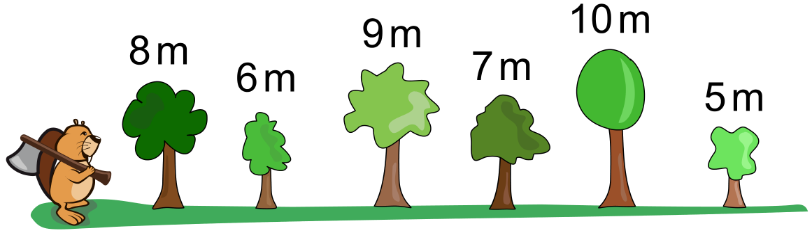

Für ihren nächsten Dammbau müssen die Biber einige Bäume fällen.

Sechs Bäume kommen in Frage. Die Biber wissen, wieviele Meter Holz jeder Baum hat. Sie wollen insgesamt möglichst viele Meter Holz haben. Den ersten Baum können sie frei wählen. Immer wenn sie danach einen nächsten Baum fällen wollen, müssen sie zwei Regeln befolgen:

- Regel 1: Der nächste Baum muss weiter rechts stehen als der vorherige.
- Regel 2: Der nächste Baum muss kleiner sein, also weniger Meter Holz haben als der vorherige.

Ein Beispiel: Wenn sie den 6m-Baum fällen, dürfen sie danach nur noch den 5m-Baum fällen. Dann haben sie am Ende insgesamt 11 Meter Holz.

**Welche Bäume können die Biber nach ihren Regeln fällen, damit sie am Ende möglichst viele Meter Holz haben? Tippe die Bäume an.**
