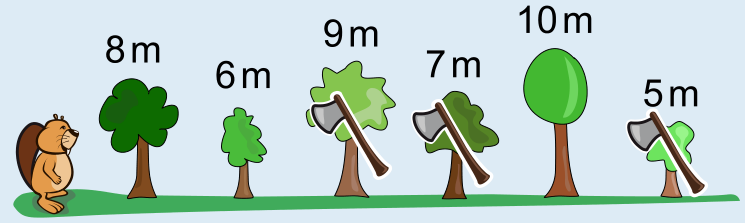

Die Aufgabe besteht darin, von links nach rechts gehend eine nach Holzmetern absteigende Teilfolge der sechs Bäume zu finden, sodass die Summe der Holzmeter in dieser Teilfolge maximal ist. Da wir die maximale Gesamthöhe suchen, müssen wir nur Teilfolgen berücksichtigen, die nicht mehr erweitert werden können, weil das Hinzunehmen egal welchen Baumes zur Teilfolge die Regeln verletzen würde. Wir nennen solche Teilfolgen *vollständig*.

Wenn wir zum Beispiel mit dem 8m-Baum (kurz: 8) beginnen, gibt es zwei vollständige Teilfolgen: 8, 6, 5 und 8, 7, 5. Die Teilfolgen 8, 7 (kann um 5 erweitert werden) und 8, 5 (kann um 6 oder 7 erweitert werden) sind nicht vollständig.

Die Tabelle zeigt alle vollständigen Teilfolgen. Außerdem gibt sie für jede Teilfolge an, wieviele Meter Holz die Biber am Ende haben, wenn sie die Bäume dieser Teilfolge fällen.

| vollständige Teilfolge | Meter Holz |
|---|---:|
| 8, 6, 5 | 19 |
| 8, 7, 5 | 20 |
| 6, 5 | 11 |
| 9, 7, 5 | 21 |
| 10, 5 | 15 |

Die Biber können also die Bäume 9, 7 und 5 nach ihren Regeln fällen, damit sie am Ende möglichst viel Holz haben, nämlich 21 Meter.

## Das ist Informatik!

Die Biber versuchen, im Rahmen ihrer Regeln eine Menge von Bäumen zu finden, so dass sie die größtmögliche Anzahl an Metern Holz bekommen. In dieser Biberaufgabe sind 21 Meter Holz das *optimale*, das heißt beste Ergebnis, das sie erzielen können. Bei der Beantwortung dieser Biberaufgabe hast du also ein *Optimierungsproblem* gelöst.

Allgemein geht es bei einem Optimierungsproblem darum, einen bestmöglichen Wert zu finden. Das kann ein größter Wert sein, wie in dieser Biberaufgabe, oder auch ein kleinster Wert, etwa wenn du den schnellsten Weg suchst, den du zur Schule nehmen kannst. Es liegt in der Natur der meisten Menschen, für ein Vorhaben nach der schnellsten, kürzesten, günstigsten oder unterhaltsamsten Variante zu suchen: Das ist Optimierung. Es ist aber auch Optimierung, wenn ein Unternehmen versucht, möglichst wenig Gehalt an seine Mitarbeiterinnen und Mitarbeiter auszuzahlen, oder bei der Vermietung von Wohnungen versucht wird, möglichst hohe Mieteinnahmen zu erzielen.

Viele Optimierungsprobleme sind so komplex, dass sie mit Hilfe von Informatiksystemen, also Computerprogrammen bzw. „Apps“ gelöst werden. Wenn ein Paketauslieferer nach Möglichkeiten sucht, die Routen der Auslieferungsfahrzeuge so zu planen, dass der Energieverbrauch möglichst gering ist, oder ein Energieversorger seine Anlagen zur Produktion erneuerbarer Energie möglichst wirtschaftlich einsetzen will, müssen so viele Daten und Bedingungen berücksichtigt werden bzw. die Steuerung so flexibel sein, dass mit Hilfe von Computern oft sehr viel bessere Ergebnisse erzielt werden als ohne. Da ist es gut, dass die Informatik viele Methoden zur Lösung von Optimierungsproblemen kennt und sagen kann, welche Methoden für welche Arten von Problemen gut eingesetzt werden können.

*Für besonders Interessierte:* Das Problem in dieser Aufgabe kennt die Informatik auch als „Maximum Sum Decreasing Subsequence“. Schau dir einmal diese Webseite an: https://www.geeksforgeeks.org/dsa/maximum-sum-increasing-subsequence-dp-14/. Dort kannst du nachverfolgen, wie man von einfachen, aber schlechten Ansätzen zur Lösung eines Optimierungsproblems nach und nach immer bessere Ansätze finden und diese in Programme umsetzen kann.
