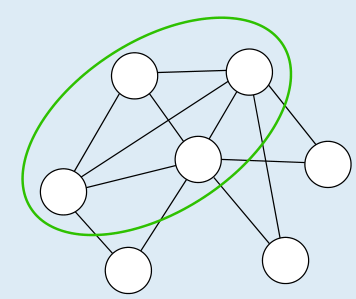
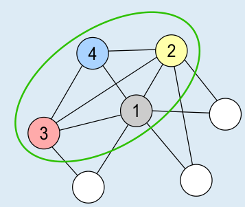
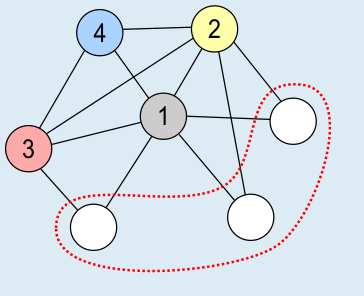
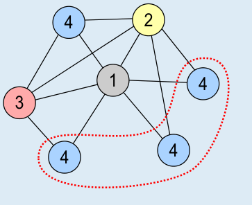
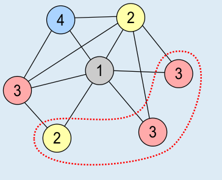

Bei genauer Betrachtung des Diagramms erkennen wir eine besondere Konstellation bei den oben links eingezeichneten Klausuren (Bild links). Jede dieser Klausuren hat mit jeder anderen einen Tageskonflikt, so dass sie an vier unterschiedlichen Tagen geschrieben werden müssen. Im Bild rechts siehst du eine Möglichkeit, diese Klausuren auf vier Tage zu verteilen. Jede andere der 1 × 2 × 3 × 4 = 24 Möglichkeiten, die Klausuren auf vier Tage zu verteilen, ist genauso richtig.

Für diese Verteilung betrachten wir nun die verbleibenden drei Klausuren (Bild links). Keine davon kann an Tag 1 geschrieben werden, aber alle an Tag 4 (Bild mitte). Wenn man die Klausuren an den Tagen 2 oder 3 schreiben möchte, geht das wegen der Tageskonflikte nur so wie im Bild rechts gezeigt. Außerdem hat man in dieser Verteilung noch sechs Möglichkeiten, eine oder zwei der für die Tage 2 und 3 angesetzten Klausuren stattdessen an Tag 4 schreiben zu lassen.

Für jede der 24 Möglichkeiten für die vier Klausuren oben links gibt es also 8 Möglichkeiten, die drei Klausuren unten rechts zu verteilen. Es gibt also 192 richtige Antworten mit den Tagen {1,2,3,4} und jeweils noch einmal so viele mit den Tagen {2,3,4,5}, {1,3,4,5}, {1,2,4,5} und {1,2,3,5}. Insgesamt sind das 5 × 192 = 960 richtige Antworten.

## Das ist Informatik!

Bei der Verteilung der Klausuren ist es hilfreich, dass die Tageskonflikte in einem übersichtlichen Diagramm dargestellt sind. Auch wenn solche „Verteilungsprobleme“ größer sind und sie mit Hilfe von Informatiksystemen gelöst werden sollen, ist es wichtig, eine hilfreiche Darstellung bzw. Modellierung der Daten zu nutzen. Das Tageskonflikt-Diagramm in dieser Biberaufgabe ist die bildhafte Darstellung eines *Graphen*, einer in der Informatik besonders wichtigen Struktur zur Modellierung von Relationen, also Beziehungen zwischen Objekten. Ein Graph besteht aus *Knoten* (hier als Kreise angezeigt) und *Kanten*, die je zwei Knoten miteinander verbinden (die Linien zwischen den Kreisen).

Das „Verteilungsproblem“, die Knoten eines Graphen mit möglichst wenigen Werten so zu markieren, dass zwei durch eine Kante verbundene Knoten unterschiedliche Werte haben, kennt die Informatik als *Färbungsproblem* (engl.: *graph coloring*) – die Markierungswerte kann man sich als unterschiedliche Farben vorstellen. Färbungsprobleme können in vielen Anwendungsbereichen vorkommen, zum Beispiel bei …

- … der Färbung von Landkarten, bei denen benachbarte Länder unterschiedliche Farben bekommen sollen;
- … der Planung von Klausuren, wie in dieser Biberaufgabe;
- … der Frequenzplanung in Mobilfunknetzen, wenn Funkstörungen zwischen benachbarten Sendemasten vermieden werden sollen; oder
- … der Verteilung von Zügen auf die Gleise eines Bahnhofs, da Züge mit überlappenden Aufenthaltszeiten verschiedene Gleise benutzen müssen.

Im Allgemeinen gehören Färbungsprobleme zu den schwierigsten Problemen, die in der Informatik bekannt sind, den sogenannten NP-schweren Problemen. Je nach Anwendungsfall ergeben sich aber spezielle Färbungsprobleme, die deutlich leichter zu lösen sind. Und in den wirklich schwierigen Fällen können Verfahren genutzt werden, die nicht garantiert optimale, aber meist sehr gute Lösungen finden.
