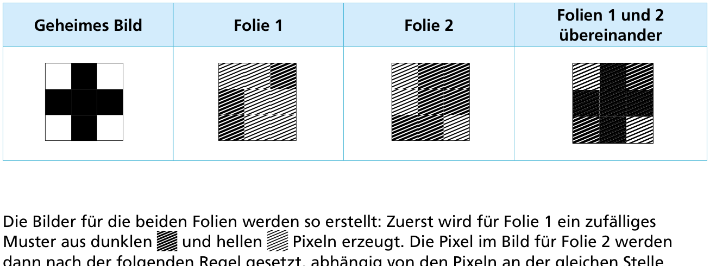
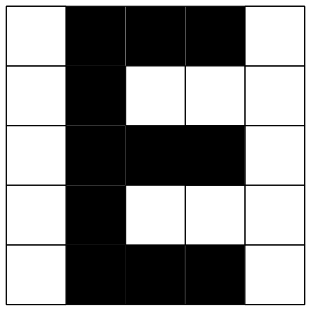
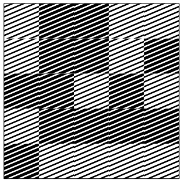

Ein geheimes Bild, das aus schwarzen und weißen Pixeln besteht, soll sicher übertragen werden. Hierfür erstellt der Kurierdienst auf transparenten Folien zwei Bilder aus dunklen und hellen (dicht bzw. locker schraffierten) Pixeln. Das geheime Bild wird erst dann erkennbar, wenn die beiden Folien übereinander gelegt werden.

Die Bilder für die beiden Folien werden so erstellt: Zuerst wird für Folie 1 ein zufälliges Muster aus dunklen und hellen Pixeln erzeugt. Die Pixel im Bild für Folie 2 werden dann nach der folgenden Regel gesetzt, abhängig von den Pixeln an der gleichen Stelle im geheimen Bild und in Folie 1:

- Ist das Pixel im geheimen Bild **schwarz**, dann müssen die Pixel in Folie 1 und Folie 2 **verschieden** sein (das eine dunkel, das andere hell).
- Ist das Pixel im geheimen Bild **weiß**, dann müssen die Pixel in Folie 1 und Folie 2 **gleich** sein (beide hell oder beide dunkel).

Für das folgende geheime Bild wurde Folie 1 bereits erzeugt.

**Erstelle nun Folie 2. Tippe die Pixel an, die dunkel sein sollen.**
