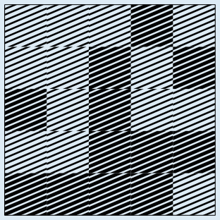
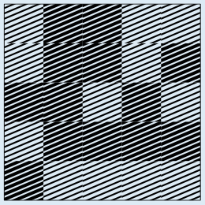
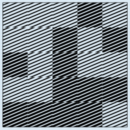
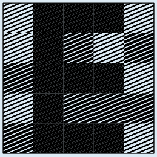

In diesem Bild für Folie 2 wurde jedes Pixel entsprechend der oben beschriebenen Regel – abhängig vom geheimen Bild und von Folie 1 – gesetzt: Das Bild unterscheidet sich nur genau an den Stellen, wo das geheime Bild schwarze Pixel hat, vom Bild für Folie 1.

Hier siehst du, wie durch Übereinanderlegen von Folie 1 und dieser Folie 2 das geheime Bild erkennbar wird:

  

## Das ist Informatik!

Der Kurierdienst verwendet ein *kryptografisches Verfahren*, das auf visueller Wahrnehmung beruht und daher *visuelle Kryptografie* genannt wird. Eine solche Technik wurde 1994 von den israelischen Wissenschaftlern Moni Naor und Adi Shamir entwickelt. In Bezug auf die einzelnen Folien ist das Verfahren sehr sicher. Da sie auf einer zufälligen Pixelmatrix basieren, kann man aus jeder Folie alleine keine Information gewinnen, selbst mit Computerhilfe nicht. Die Entschlüsselung ist nur möglich – und dann sogar recht einfach – wenn beide Folien vorhanden sind.

Zur Übertragung geheimer Nachrichten könnte eine zufällige, aber feste Folie 1 sowohl beim Absender als auch beim Empfänger als „Schlüssel“ gespeichert werden. Dann müsste für jede neue Nachricht nur noch Folie 2 erzeugt und übermittelt werden. Wenn man den Schlüssel, also die Folie 1 jedoch mehrfach verwendet, ist das Verfahren nicht mehr ganz sicher. Dieses Problem hat man generell bei Verschlüsselungen, die nach dem Prinzip des *One-Time-Pad* funktionieren. Dabei muss der Schlüssel (mindestens) genau so lang sein wie die geheime Nachricht und muss zufällig erzeugt werden. Die Verschlüsselung wird durch eine umkehrbare Verknüpfung der passenden Zeichen aus Nachricht und Schlüssel erzeugt. In der Informatik wird für die Nachrichten aus Bits, die Computer miteinander austauschen, in der Regel die Operation XOR als eine solche umkehrbare Verknüpfung verwendet. Die Kombination der hellen und dunklen Pixel in dieser Biberaufgabe entspricht genau dieser Operation.
