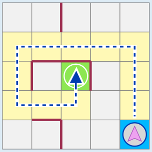
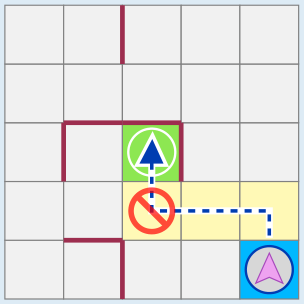

Wenn Lefty über diese Felder fährt, erreicht er das Ziel. Dabei bewegt er sich nur auf die beiden Arten, die er kann.

Es gibt keinen anderen Weg mit weniger oder gleich vielen Feldern, auf dem Lefty das Ziel erreicht.

Den direkten Weg kann Lefty nicht nehmen, weil er dafür rechts abbiegen müsste.

## Das ist Informatik!

Armer Lefty! Seine Funktionsweise ist stark eingeschränkt. Wenn er doch nur andere Bewegungen machen könnte! Wenn er sich nach rechts drehen und vielleicht sogar über Mauern klettern könnte, wäre sein Leben im Raster viel einfacher. Lefty würde sich viel selbstbewusster fühlen, wenn er einen *komplexeren Befehlssatz* hätte. (Bei einem Roboter werden die grundlegenden Dinge, die er tun kann, durch entsprechende Befehle in der Software des Roboters gesteuert.)

Aber ist das wirklich notwendig? Lefty könnte sich zum Beispiel nach rechts drehen, indem er sich dreimal hintereinander nach links dreht. Wir müssen nur die Regel abschaffen, dass sich Lefty nach der Linksdrehung sofort nach vorne bewegen muss. Dann könnte er sich in alle Richtungen drehen und fahren. Und anstatt über eine Mauer zu klettern, könnte er um sie herumfahren, wenn dafür genug Platz ist. Hey Lefty, du kannst mit deinem *reduzierten Befehlssatz* glücklich und zufrieden leben – solange die, die dich programmieren, die Befehle klug einsetzen.

In der Informatik sind genau diese beiden Ansätze, den Befehlssatz eines *Prozessors* zu gestalten, am weitesten verbreitet: Manche Prozessoren sind ein CISC (*Complex Instruction Set Computer* / deutsch: Computer mit komplexem Befehlssatz), andere sind ein RISC (*Reduced Instruction Set Computer* / Computer mit reduziertem Befehlssatz) – wie jener von Lefty in dieser Biberaufgabe. Ein CISC hat in der Regel viele verschiedene Befehle, die sehr mächtig sein können (wie das Klettern über eine Mauer), aber dafür seltener verwendet werden. Ein RISC hingegen hat nur wirklich nötige Befehle mit eher einfacher Wirkung, die dann häufig verwendet werden.

Beide Arten von Architekturen haben ihre Vor- und Nachteile. Die Prozessoren bekannter Marken sind entweder CISC- oder RISC-Prozessoren, wobei RISC-Prozessoren in letzter Zeit etwas beliebter geworden sind.
