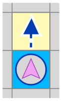
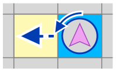
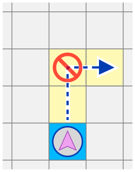
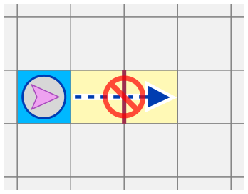

Roboter Lefty (blauer Kreis mit rosa Pfeil) bewegt sich über ein Raster mit quadratischen Feldern. Zwischen Feldern kann es rote Mauern geben. Lefty soll das grüne Ziel erreichen. Lefty kann sich auf genau zwei Arten bewegen:

**Ein Feld vorwärts fahren**

**Nach links drehen und dann sofort ein Feld vorwärts fahren**

Lefty kann aber nicht alles. Zum Beispiel kann er …

**… nicht einfach rechts abbiegen und …**

**… nicht durch Mauern fahren.**

**Über welche Felder muss Lefty fahren, um das Ziel zu erreichen?** Tippe die Felder an, über die Lefty fährt (Start- und Zielfeld nicht mitgezählt).
