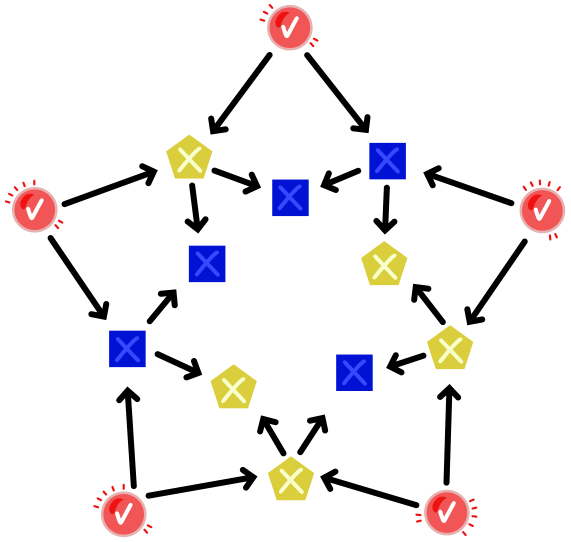

In ihrem Elektronikkasten hat Sophie drei Sorten Lichter: runde rote, quadratische blaue und fünfeckige gelbe. Sie hat einige Lichter zu einem Lichterstern verkabelt. Die Pfeile zeigen, wie die Kabel liegen.

Die blauen und gelben Lichter werden über die Kabel gesteuert, in Pfeilrichtung. Jedes blaue oder gelbe Licht hat also genau zwei „Steuer-Lichter“.

So funktionieren die Lichter:

- Die roten Lichter kann Sophie selbst an- und ausschalten.
- Ein blaues Licht ist an, wenn beide Steuer-Lichter an sind; sonst ist es aus.
- Ein gelbes Licht ist an, wenn genau eines der beiden Steuer-Lichter an ist; sonst ist es aus.

Sophie schaltet alle roten Lichter an.

**Welche anderen Lichter sind dann auch an?**
