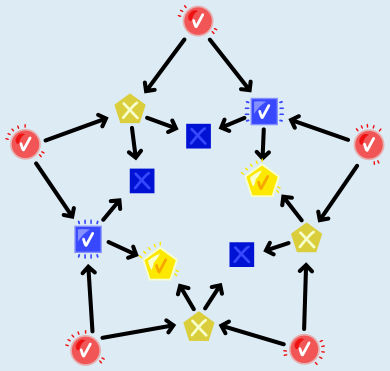
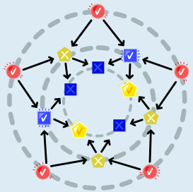
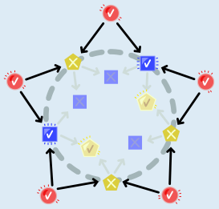
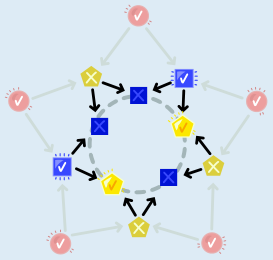

Die Lichter bilden drei Ringe: einen äußeren mit allen roten Lichtern sowie einen mittleren und einen inneren mit blauen und gelben Lichtern.

Alle roten Lichter und damit alle Steuer-Lichter für die mittleren Lichter sind an. Damit sind im mittleren Ring genau die blauen Lichter an (weil beide Steuer-Lichter an sind), und die gelben Lichter sind aus (weil beide Steuer-Lichter an sind, also nicht genau ein Steuer-Licht an ist).

Im inneren Ring ist es genau anders herum: Jedes Licht im inneren Ring hat je ein gelbes und blaues Steuer-Licht aus dem mittleren Ring. Wir wissen schon, dass von diesen beiden Lichtern immer genau eines an ist. Deswegen sind im inneren Ring genau die gelben Lichter an, und die blauen Lichter sind aus.

## Das ist Informatik!

Die Lichter in Sophies Stern können nur an- oder ausgeschaltet sein. Wir können dazu auch sagen, dass jedes Licht zwei Werte haben kann, nämlich „an“ und „aus“ – so wie eine Ampel im Straßenverkehr drei Werte haben kann, nämlich „rot“, „gelb“ und „grün“, oder eine Uhr mit Digitalanzeige 1.440 Werte haben kann, nämlich alle Uhrzeiten von 00:00 bis 23:59, oder die Anzeige des Gesamtbetrags an einer Supermarktkasse viele Geldbeträge als Werte haben kann.

Mit Zahlen kann man rechnen, nämlich mit *Operatoren* für Zahlen wie plus und minus. Auch für die zwei Werte der Lichter gibt es Operatoren, und dabei ist es egal, ob die Werte „an“ und „aus“, „wahr“ und „falsch“ oder „1“ und „0“ heißen. Diese Operatoren rechnen aus zwei *Eingabewerten* ein Ergebnis aus. In dieser Biberaufgabe werden zwei solche Operatoren verwendet:

- Der Wert der blauen Lichter wird mit dem Operator AND (englisch für „und“) ausgerechnet: Das Ergebnis von UND ist 1, wenn beide Eingabewerte 1 sind, sonst ist es 0.
- Der Wert der gelben Lichter wird mit dem Operator XOR (für „exklusives oder“) ausgerechnet: Das Ergebnis von XOR ist 1, wenn die Eingabewerte verschieden sind, sonst ist es 0.

XOR ist übrigens nicht exklusiv, weil es besonders teuer ist. „Exklusiv“ bedeutet, es wird ausgeschlossen, dass das Ergebnis auch dann 1 ist, wenn beide Eingabewerte 1 sind. Es gibt auch einen Operator, der wie XOR funktioniert, aber ohne diesen Ausschluss; er heißt OR („oder“).

In der Informatik sind diese und einige weitere Operatoren auch als *logische Operatoren* bekannt. Logische Operatoren kann man gut als elektronische Schaltungen bauen. Die wiederum sind Grundbausteine von Computerprozessoren, denn auch die kleinste Einheit im Computer, das Bit, hat zwei Werte. Geschickt zusammengebaut kann man mit ihnen komplizierte Berechnungen machen, Programmabläufe steuern oder sogar jedes beliebige Programm schreiben.
