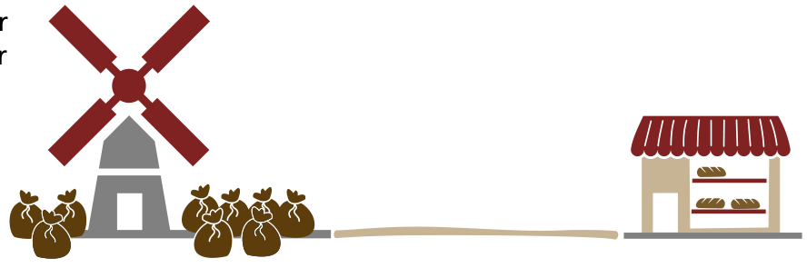

Albert und Marco arbeiten in einer Bäckerei. Sie müssen immer wieder Mehl von der Mühle holen gehen. Es darf aber immer nur einer gehen, damit der andere die Kunden bedienen kann.

Ihre Leistungen beim Mehl holen sind unterschiedlich:

- Albert holt 13 kg Mehl in 1 Stunde.
- Marco holt 5 kg Mehl in 30 Minuten.

Für jeden der beiden gilt aber: Er kann höchstens dreimal direkt hintereinander Mehl holen. Nach dreimal Mehl holen sind 30 Minuten Erholung nötig. In dieser Zeit können Kunden bedient werden.

Albert und Marco möchten zusammen in 8 Stunden so viel Mehl wie möglich holen.

**Unter genau einer der folgenden Bedingungen schaffen sie das. Unter welcher?**
