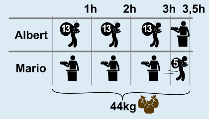
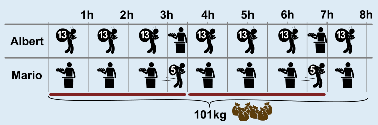

**Antwort A ist richtig.**

Wir wissen:

- Albert holt 13 kg pro Stunde.
- Marco holt 5 kg in 30 Minuten, also 10 kg pro Stunde.
- Einer muss immer in der Bäckerei bleiben.
- Jeder darf höchstens dreimal hintereinander gehen, danach muss er 30 Minuten in der Bäckerei bleiben.
- Während einer in der Bäckerei bleibt, kann der andere weiter Mehl holen gehen.

Albert schafft mehr Mehl pro Stunde als Marco. Deshalb sollte er so oft wie möglich gehen. Marco geht nur, wenn Albert sich nach dreimal Gehen erholt. Auf diese Weise können sie in 3,5 Stunden maximal 44 kg Mehl holen:

Weil Albert danach erholt ist, können sie dieses Muster (kurz: A, A, A, M) wiederholen und in 7 Stunden 88 kg Mehl holen. Dann kann Albert noch einmal gehen. Insgesamt holen sie also in 8 Stunden maximal 101 kg Mehl, wenn Albert zuerst geht.

**Antwort B:** Auch wenn Marco zuerst geht, können sie in 3,5 Stunden 44 kg Mehl holen, diesmal aber nach dem Muster (M, A, A, A). Nach zwei Wiederholungen und 88 kg Mehl ist noch eine Stunde übrig. Weil Albert sich dann erholen muss, muss Marco in dieser Stunde zweimal gehen und 10 kg Mehl holen. Insgesamt können sie unter dieser Bedingung weniger Mehl holen als oben, nämlich 44 + 44 + 10 = 98 kg.

**Antwort C und D:** Wenn Marco zuletzt geht, kann Albert nicht zuletzt gehen. Also sind Antwort C und D gleichbedeutend. Auch unter diesen Bedingungen können sie in 7 Stunden 88 kg Mehl holen, aber in der letzten Stunde wieder nur 10 kg, insgesamt also wieder nur 44 + 44 + 10 = 98 kg.

**Antwort E:** Wenn Marco genau einmal geht, können sie in den ersten 3,5 Stunden wieder 44 kg Mehl holen. In den zweiten 3,5 Stunden muss Albert sich aber 30 Minuten lang erholen; und weil Marco nicht noch einmal gehen darf, holen sie in dieser Zeit 39 kg. Danach kann Albert noch einmal gehen, so dass sie unter dieser Bedingung nur 44 + 39 + 13 = 96 kg Mehl holen können.

## Das ist Informatik!

Wenn Albert und Marco in einer bestimmten Zeit möglichst viel Mehl holen wollen, müssen sie ein Planungs- und Optimierungsproblem lösen:

- Sie müssen ihre Gänge planen und dabei Beschränkungen (Ruhezeiten und Belegungsbeschränkung) einhalten.
- Sie müssen die Gänge zwischen Albert und Marco aufteilen.
- Sie wollen die Gesamtmenge des geholten Mehls maximieren (Optimierungsziel).

*Planungs- und Optimierungsprobleme* treten in vielen Bereichen des Lebens auf. Das wichtigste Ziel dabei ist *Effizienz*; das bedeutet einfach gesagt, unter gegebenen Bedingungen möglichst viel zu schaffen. In Produktionsanlagen soll mit den vorhandenen Personen und Maschinen möglichst viel produziert werden, an einem Flughafen sollen an den vorhandenen Check-In-Schaltern und Flugsteigen möglichst viele Flüge und Passagiere abgefertigt werden, und so weiter. Sobald Planungs- und Optimierungsprobleme größer werden, helfen Computerprogramme dank Methoden der Informatik, sie zu lösen. Solche Probleme, bei denen Bedingungen zu beachten sind, kommen aber auch in der Informatik selbst vor, denn auch Computerprozessoren sollen effizient sein. Zwei Beispiele: Bei der Ausführung von Befehlen muss berücksichtigt werden, dass arithmetische Logikeinheiten jeweils nur einen Befehl gleichzeitig ausführen können (Belegungsbeschränkung). Befehle, die Daten aus dem Speicher lesen, müssen auf das Eintreffen der Daten warten und haben dann „Ruhezeiten“ – so wie Albert und Marco nach dreimal Gehen in dieser Biberaufgabe.
