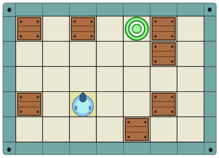
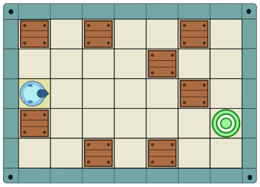
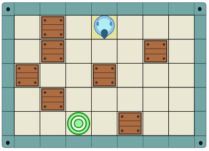

In einem von Momos Computerspielen kann ein Roboter (blauer Kreis mit Pfeil) über Felder fahren. Wenn er vor ein Hindernis (braune Kiste) oder die Wand fährt, geht es nicht mehr weiter. Dann muss der Roboter die Richtung wechseln.

In jedem Level des Spiels können die Hindernisse und auch das Ziel (grüne Zielscheibe) woanders sein. Ein Level ist geschafft, wenn der Roboter das Ziel erreicht.

Momo kann den Roboter mit Programmen steuern. Für seine Programme kann er diese vier Befehle benutzen:

1. Fahre ein Feld vorwärts.
2. Fahre vorwärts, bis es nicht mehr weitergeht.
3. Drehe dich um 90 Grad gegen den Uhrzeigersinn.
4. Drehe dich um 90 Grad im Uhrzeigersinn.

Momo kennt die nächsten drei Level. Er möchte ein Programm mit möglichst wenigen Befehlen haben, das alle drei Level schafft.

**Erstelle so ein Programm für Momo!**
