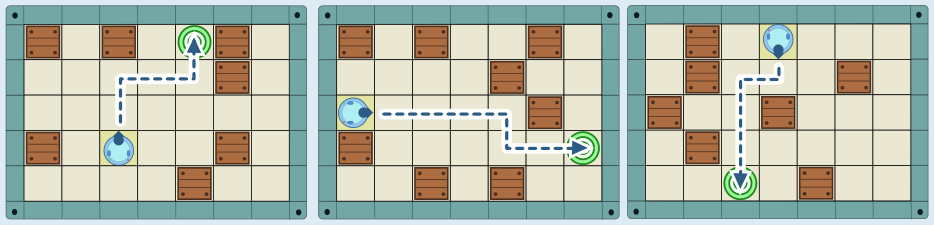

Die einzelnen Level kann man jeweils mit mehreren verschiedenen Programmen schaffen. Aber nur ein Programm schafft alle drei Level:

1. Fahre vorwärts, bis es nicht mehr weitergeht.
2. Drehe dich um 90 Grad im Uhrzeigersinn.
3. Fahre vorwärts, bis es nicht mehr weitergeht.
4. Drehe dich um 90 Grad gegen den Uhrzeigersinn.
5. Fahre vorwärts, bis es nicht mehr weitergeht.

Die Pfeile zeigen, wie das Programm den Roboter in den drei Leveln steuert:

In Level 1 (links) befindet sich das Ziel rechts oberhalb vom Roboter. Deshalb muss der Befehl „Fahre vorwärts, bis es nicht mehr weitergeht“ mindestens zweimal verwendet werden: einmal, um nach rechts zu gelangen, und einmal, um nach oben zu gelangen. Der Roboter blickt anfangs nach oben und soll am Ende auch wieder nach oben blicken. Er muss sich also zuerst im Uhrzeigersinn drehen, um nach rechts zu gehen, und später gegen den Uhrzeigersinn, um wieder nach oben zu blicken. Ein Programm, das Level 1 schafft, hat also mindestens vier Befehle.

In Level 2 (mitte) muss der Roboter auf dem Weg nach rechts ein Hindernis umgehen und benötigt dafür den Befehl „Fahre vorwärts, bis es nicht mehr weitergeht“ einmal mehr. Ein Programm, das Level 2 schafft, hat also mindestens fünf Befehle.

Das Programm mit fünf Befehlen schafft auch die Level 1 und 3 (rechts). Ein kürzeres Programm für alle drei Level gibt es nicht.

## Das ist Informatik!

Die vier Roboter-Befehle in dieser Biberaufgabe bilden eine kleine Programmiersprache. Durch Aneinanderreihung der Befehle kann der Roboter gesteuert werden. In der Informatik nennt man solche Aneinanderreihungen *Befehlsfolgen* oder *Sequenzen*. Die Sequenz ist die einfachste und grundlegendste *Kontrollstruktur* in der strukturierten Programmierung.

Der Befehl „Fahre ein Feld vorwärts.“ wird für die richtige Antwort nicht benötigt. Das Programm enthält stattdessen mehrmals den Befehl „Fahre vorwärts, bis es nicht mehr weitergeht“. Mit diesem Befehl wird der Vorwärtsschritt so lange wiederholt, bis der Roboter auf ein Hindernis oder den Spielfeldrand stößt. In der strukturierten Programmierung sind *Wiederholungen* eine weitere grundlegende Kontrollstruktur. Es gibt Wiederholungen mit einer festen Anzahl („Fahre fünf Felder vorwärts.“), aber wichtiger sind Wiederholungen mit *Abbruchbedingungen*, wie in „Fahre vorwärts, bis es nicht mehr weitergeht“. Weil der Roboter mit diesem Befehl unterschiedlich lange gerade Strecken fahren kann, kann das Programm alle drei Level schaffen.

Du kannst dir sicher Level ausdenken, die das Programm nicht schaffen kann, z. B. wenn der Roboter mehrmals die Richtung wechseln muss, um das Ziel zu erreichen. Informatikerinnen und Informatiker versuchen, die Algorithmen für ihre Programme so zu entwerfen, dass sie nicht auf bestimmte Fälle zugeschnitten sind, sondern allgemein funktionieren, also für alle denkbaren Fälle. Dazu schauen sie auch, ob es für verwandte Probleme schon Lösungsalgorithmen gibt. Die Level in Momos Spiel sind ein wenig wie Irrgärten, und für Irrgärten gibt es solche allgemeinen Lösungsalgorithmen. Die bestimmen zwar in manchen Fällen Wege zum Ziel, die komplizierter sind als nötig, sind aber für alle Fälle erfolgreich.
