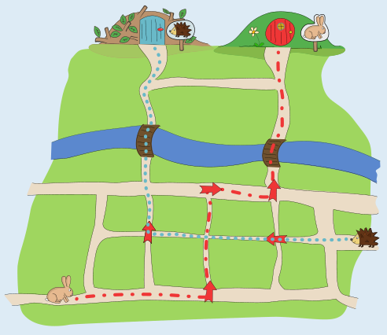
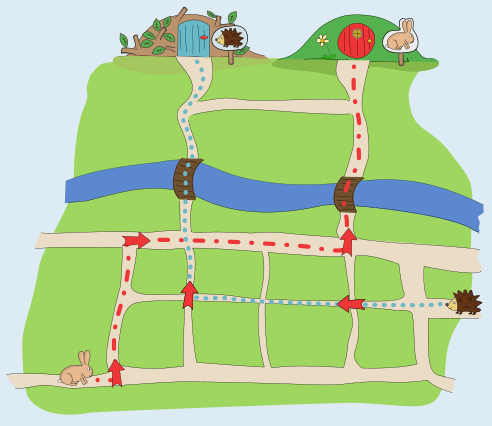

---
answers:
  - "1c:right,1d:up,3c:up"
  - "1a:right,1d:up,3a:up"
---
Es gibt zwei richtige Antworten:

Um nach Hause zu kommen, muss der Hase irgendwann nach „oben“ (in Richtung der Häuser) gehen. Das kann er an der ersten oder der dritten Kreuzung machen, an die er kommt.

Wichtig ist, dass Hase und Igel auf ihren Wegen nie zu demselben Pfeil kommen, weil sie sonst beide von dort aus denselben Weg laufen und somit beide am selben Haus ankommen würden. Das würde zum Beispiel passieren, wenn der Hase an der zweiten oder vierten Kreuzung nach oben geht und zu Pfeilen kommt, die dem Igel den Weg nach Hause weisen. Auch an der fünften Kreuzung kann der Hase nicht nach oben gehen; er müsste dann später nach links, aber es ist kein Pfeil übrig, der nach links zeigt.

Der Hase kann also nur an der ersten oder dritten Kreuzung nach oben gehen. Die anderen Pfeile müssen dann jeweils so gelegt werden wie oben abgebildet. Nur so kommt der Hase nach Hause, und der Weg des Igels nach Hause wird nicht gestört.

## Das ist Informatik!

Auf ihrem Weg folgen Hase und Igel an den Kreuzungen dieser Vorschrift: „Wenn an der Kreuzung ein Pfeil liegt, folge der Richtung des Pfeils. Sonst gehe geradeaus.“

In der Informatik nennt man solch eine Vorschrift *Algorithmus*. Der Algorithmus bleibt immer gleich: Er sagt, ob und wie man die Richtung ändert, wenn man an eine Kreuzung kommt. Die Richtungsänderungen werden von den Pfeilen bestimmt. Sie sind Daten, die der Algorithmus *verarbeitet*; in der Informatik spricht man auch von *Eingaben* für den Algorithmus. Im Hase-Igel-Wege-Algorithmus dieser Biberaufgabe bestimmt die Eingabe, also Lage und Art der Pfeile, ob die Ausgabe des Algorithmus richtig ist, also ob die Wege, welche die Tiere gehen, sie beide nach Hause führen.

Eine ähnliche Vorschrift könnte es beim Waschen eines Kleidungsstücks geben: „Wähle die Waschtemperatur so wie auf dem Waschzettel angegeben.“ Nur wenn die Eingabe, also die Temperatur-Angabe auf dem Waschzettel, stimmt, ist auch die Ausgabe richtig, also ein sauberes Kleidungsstück, das noch genau so groß ist wie vor dem Waschen.

Diese Beispiele zeigen, dass es kritisch ist, wenn die Qualität der Ausgaben eines Algorithmus von der Qualität der Eingaben abhängt. Das ist zum Beispiel bei vielen KI-Systemen der Fall. KI-Systeme arbeiten mit Modellen der Wirklichkeit, die aus Daten gebildet werden. Sind diese Daten nicht gut ausgewählt, wird das Modell nicht gut funktionieren: es hat einen *Bias* (deutsch: Verzerrung). Ein KI-Modell von Krankheiten etwa wird für Frauen nicht gut funktionieren, wenn die Eingabedaten nur von Männern stammen.
