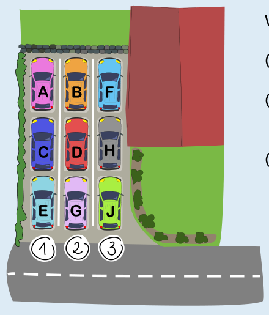

Wir beobachten zunächst:

- (a) Frank fährt zuletzt weg, muss daher ganz vorne parken.
- (b) Gabi fährt zuerst weg, muss daher in einer der 3 Spuren ganz hinten parken.
- (c) Beata fährt als Dritte weg, daher müssen David und Gabi hinter ihr parken.

Damit können wir weitere Überlegungen anstellen:

- Wegen (a) bleibt für Frank nur der Platz neben Beata, vorne in Parkspur 3.
- Nach Ana, Beata und Clara kommt David an. Wegen (c) muss David hinter Beata in Parkspur 2 parken.
- Gabi muss wegen (c) hinter David in Parkspur 2 parken.
- Für Emir bleibt nur Parkspur 1 hinter Clara. Emir fährt als Vierter (nach Gabi, David, Beata) ab und muss deswegen ganz hinten in einer Spur stehen. Wenn er ankommt, kommt dafür nur Parkspur 1 in Frage, denn in Parkspur 3 steht bisher nur Frank, so dass Emir dort auf den mittleren Platz müsste.
- Schließlich bleibt nur Parkspur 3 für Harald (mittlerer Platz) und Julia (hinten) übrig. Zum Glück will Julia vor Harald wegfahren – sonst gäbe es keine richtige Antwort.

Weil für jedes einzelne Auto genau eine feste Parkposition in Frage kommt, gibt es nur die eine richtige Antwort.

## Das ist Informatik!

Die geparkten Autos in den 3 Parkspuren verhalten sich so, dass nur das zuletzt geparkte Auto wegfahren kann. Das ist so wie bei einem Stapel Teller, bei dem man nur den zuletzt auf den Stapel gelegten Teller gefahrlos wegnehmen kann.

Auch die Informatik kennt einen *Stapel* (engl.: *stack*), und zwar als Datenstruktur. Sie funktioniert analog zu Parkspuren oder Tellerstapeln: Die Operation *push* fügt ein Daten-Objekt dem Stapel hinzu. Die Funktion *top* liefert das zuletzt hinzugefügte Objekt, und die Operation *pop* entfernt es aus dem Stapel. In der theoretischen Informatik wiederum gibt es Berechnungsmodelle, die Stapel verwenden. Ein Automat mit einem Stapel (in der theoretischen Informatik auch *Keller* oder *Kellerspeicher* genannt) entspricht den sogenannten *kontextfreien Sprachen*, die von Computern gut verarbeitet werden können; Beispiele dafür sind Programmiersprachen oder Markup-Sprachen wie HTML.

Mehrere Stapel – so wie die mehreren Parkspuren in dieser Biberaufgabe – werden zum Beispiel in Computer-Betriebssystemen verwendet, um Aufgaben an mehrere Prozessoren zu verteilen. Wenn man dem Stapel-Automaten aus der theoretischen Informatik mindestens einen weiteren Stapel hinzufügt, kann man damit beliebige Berechnungen modellieren, so wie mit einer Turingmaschine. Der zweite Stapel macht den Unterschied!
