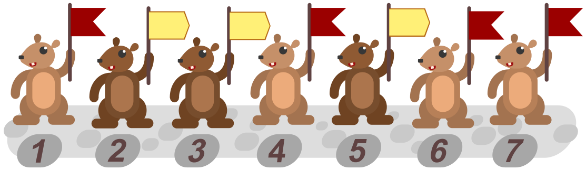

Der Biber-Boss setzt vier sogenannte *Nachrichten-Biber* ein: Sie halten Flaggen hoch, um Nachrichten zu senden. Jeder Nachrichten-Biber hält entweder eine **rote** oder eine **gelbe** Flagge hoch.

Manchmal passiert es, dass ein Biber die falsche Flagge hochhält. Das möchte der Biber-Boss erkennen können. Deshalb bestimmt er zusätzlich drei *Prüf-Biber*.

Jeder Prüf-Biber prüft drei Nachrichten-Biber. Wenn diese drei eine ungerade Anzahl an roten Flaggen hochhalten sollen, dann soll ihr Prüf-Biber auch eine rote Flagge hochhalten, sonst eine gelbe. Wenn alle die richtigen Flaggen hochhalten, dann halten ein Prüf-Biber und seine Nachrichten-Biber zusammen eine gerade Anzahl von roten Flaggen hoch.

Der Boss nummeriert die Nachrichten- und Prüf-Biber und ordnet sie so einander zu:

| Nachrichten-Biber | Prüf-Biber |
|-------------------|-----------:|
| 1, 2, 3           | 5          |
| 1, 2, 4           | 6          |
| 2, 3, 4           | 7          |

Insgesamt werden in einer Nachricht nun sieben Flaggen hochgehalten. Der Biber-Boss sieht die Nachricht unten. Er bemerkt, dass genau einer der sieben Biber die falsche Flagge hochhält.

**Welcher Biber hält die falsche Flagge hoch?**
