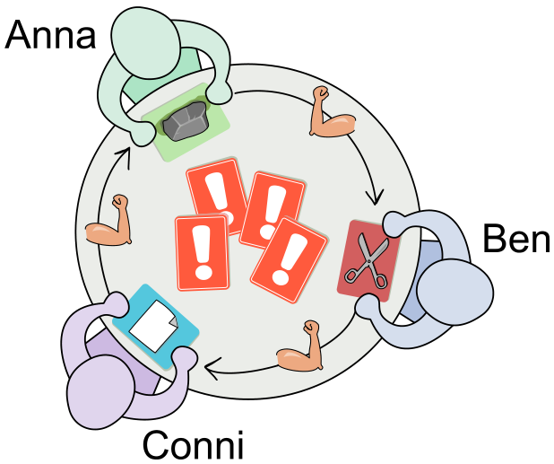

Anna, Ben und Conni spielen gemeinsam eine Runde Schere-Stein-Papier. Sie spielen gleichzeitig paarweise gegeneinander.

Jeder hat eine Spielkarte gezogen: Anna hat Stein, Ben hat Schere und Conni hat Papier:

Es gelten die klassischen Regeln: Stein schlägt Schere, Schere schlägt Papier, Papier schlägt Stein. So wie die Karten jetzt verteilt sind, würde jeder einmal gewinnen und einmal verlieren. Zum Beispiel gewinnt Ben gegen Conni und verliert gegen Anna.

Bevor das Ergebnis für jedes Spielerpaar ausgewertet wird, muss aber noch eine von vier Aktionskarten gewählt und deren Aktion ausgeführt werden. Bei den Aktionen geht es darum, mehrfach Spielkarten zwischen je zwei Spielern zu tauschen. Bei jedem Tausch kann neu entschieden werden, welche zwei Spieler miteinander tauschen – es sei denn, die Aktion sagt etwas anderes.

Ben möchte unbedingt gegen Conni gewinnen, egal wie die Aktion auf der gewählten Aktionskarte ausgeführt wird.

**Nur eine der vier Aktionen garantiert das. Welche?**
