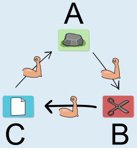
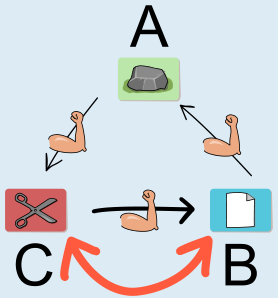
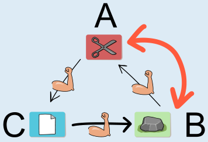
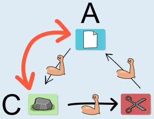

**Antwort D ist richtig:**

Zunächst beobachten wir, dass Ben mit seiner ursprünglichen Spielkarte (Schere) gegen Conni gewinnen würde (Schere schlägt Papier). Es gilt, dies beizubehalten. Drei der vier Aktionskarten bergen das Risiko, dass Ben am Ende gegen Conni verliert. Nur die Aktionskarte von Antwort D führt *unter keinen Umständen* dazu.

Eine Erkenntnis ist hilfreich: Alle drei Spielkarten sind verschieden, und die Regeln sagen, dass jede Karte gegen eine andere Karte gewinnt und gegen eine andere verliert. Wenn die Spieler im Kreis sitzen, gewinnt jeder gegen den einen Nachbarn und verliert gegen den anderen. Durch einen Tausch ändern sich die Ergebnisse aller Paarungen, egal welche zwei Spieler ihre Karten tauschen:

Nach einer geraden Anzahl Tausche sind also die ursprünglichen Ergebnisse wieder hergestellt. Bei einer ungeraden Anzahl Tausche hingegen sind alle Ergebnisse geändert. Da Ben zu Beginn gegen Conni gewinnt, können wir nur dann sicherstellen, dass er nach Ausführung der Aktion immer noch gegen Conni gewinnt, wenn eine gerade Anzahl Tausche stattfindet. Und das ist nur bei der Aktion von Antwort D garantiert der Fall.

## Das ist Informatik!

Bei der Beantwortung dieser Biberaufgabe war zunächst wichtig zu erkennen, dass sich die Ergebnisse für alle Spielerpaare durch einen einzelnen Tausch komplett umdrehen. Entscheidend: Das passiert auch dann, wenn das Spielerpaar selbst seine Karten nicht tauscht. Das Ergebnis zwischen Ben und Conni ändert sich also auch dann, wenn Ben und Conni zwar nicht miteinander tauschen, aber eben Ben mit Anna oder Conni mit Anna tauscht. Eine *lokale Veränderung* zwischen einem Paar hat also auch einen *globalen Effekt* auf alle Paare. Bei der Entwicklung von Computerprogrammen können solche *Seiteneffekte* zu Problemen führen, insbesondere wenn sie unbeabsichtigt auftreten. Dann ist die Sicherheit und Verlässlichkeit der Programme gefährdet.

Sicherheit und Verlässlichkeit von Informatiksystemen spielen für die Informatik eine zentrale Rolle. Besonders offensichtlich ist das bei Systemen, deren Versagen unmittelbar zu großen Schäden führen kann, wie bei Systemen zur Steuerung von Verkehrsmitteln, Kraftwerken oder schweren Waffen. Aber auch Systeme, die persönliche Daten verarbeiten, sollten dies sicher und verlässlich tun.

Dafür ist wichtig, dass die beim Betrieb des Systems eingesetzten Programme korrekt sind. Ein Programm ist korrekt, wenn es für jede Eingabe terminiert und ein den Vorgaben entsprechendes Ergebnis liefert (und so ähnlich kann man Korrektheit auch für Algorithmen beschreiben). Zumindest für wichtige Programme wird versucht, die Korrektheit auch zu beweisen. Dabei spielen u. a. *Invarianten* eine Rolle. So heißen per Logik formulierbare Bedingungen, die z. B. bei Wiederholungsanweisungen zu Beginn jeder einzelnen Wiederholung gültig sind. In dieser Biberaufgabe gilt die Invariante „Ben gewinnt gegen Conni“, wenn jede Wiederholung von Kartentauschen zwei Tausche enthält und dadurch insgesamt eine gerade Anzahl von Kartentauschen durchgeführt wird.
